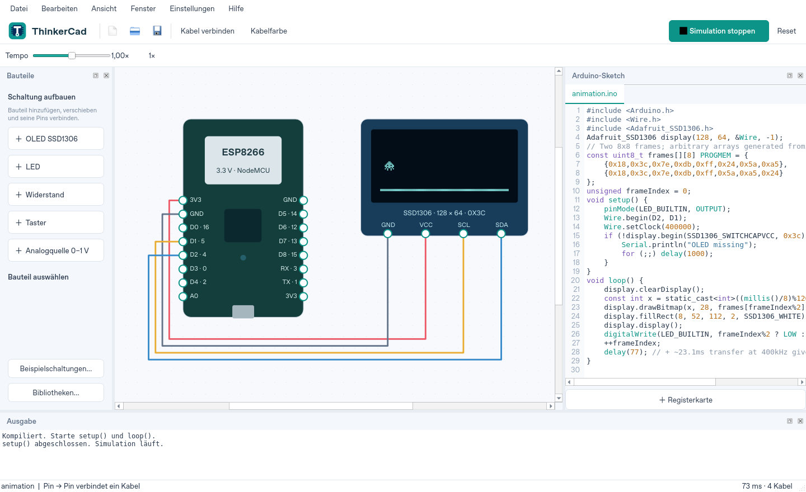
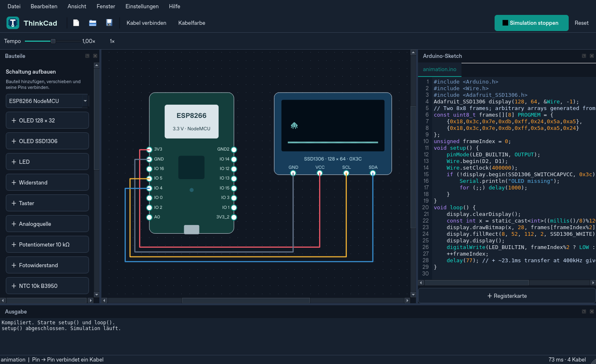

# ThinkCad

Native 2D-Desktop-Anwendung in **C++20 und Qt 6**, für **Windows und Linux**. **macOS wird nicht unterstützt.**
ThinkCad bietet ESP8266-, ESP32-Varianten, RP2040-/Pico-, STM32-Basis-,
Arduino-Uno-R3- und klassische Arduino-Nano-Boardprofile, elektrische Bauteile,
erweiterbare Sensormodule und Notizen,
SSD1306-OLEDs, einen Sketch-Editor und eine compilerbasierte Arduino-API-Teilmenge.





## Neu in 1.2.7

- Robuste SHA-Abfrage im Updater auch für große Release-Commits.
- Offline-Changelogs unter Hilfe und vollständige Einstellungen direkt im Hauptmenü.
- Batterien und Gleichspannungsquellen auch in eigenständigen Stromkreisen und in Reihe.

[Release Notes 1.2.7](docs/RELEASE_NOTES_1.2.7.md)

## Neu in 1.2.6

- Projektmodus **Simulation / Emulation**, globaler Standard und kompatibles Laden alter Projekte.
- Moderne Boardprofile und BME280, MPU6050, DHT22, HC-SR04, DS18B20,
  WS2812B, RC522, L298N und MCP3008; echte ausgewählte Bibliotheken und lokale Datenpakete.
- Native [Quellcode-Debugger](docs/SOURCE_DEBUGGER.md),
  [Pin-/Register-/Bus-Inspektoren und Sensorsteuerung](docs/SIMULATION_INSPECTOR.md).
- [Lokale LAN-Zusammenarbeit](docs/LOCAL_COLLABORATION.md) mit getrennten Speicherpfaden,
  Konfliktauflösung und gesicherten lokalen Entwürfen; kein Konto oder zentraler Server.
- Gruppierte Einstellungen und sechs Sprachen für die neuen Werkzeuge.
- Fünf verdrahtete Beispiele, darunter Pico/BME280, ESP32-S3/MPU6050 und zwei UART-Sketches.
- Gentoo: optionales USE-Flag `debugger` installiert lokales GDB; `examples`, `test`,
  `X` und `wayland` bleiben verfügbar. Windows bündelt GDB; Linux-Pakete empfehlen es.

[Release Notes 1.2.6](docs/RELEASE_NOTES_1.2.6.md) ·
[Modellgrenzen](docs/development/1.2.6-device-matrix.md)

## Neu in 1.2.4: Montage und MIDI

Direkt steckbare Kontakte mit Vorschau, Kabel über Bauteilen, Breadboard mit
Stromschienen, Matrix-Keypad, 25-Tasten-Keyboard, Drehencoder, serieller
MIDI-Monitor/-Übersetzer und ein separates 88-Tasten-Piano für den Piezo.
[Release Notes 1.2.4](docs/RELEASE_NOTES_1.2.4.md)

[Bedienung, Beispiele und Modellgrenzen](docs/ASSEMBLY_AND_MIDI.md)

## Neu in 1.2.3

- PWM-fähige Pins aller Mikrocontroller sind in beiden Ansichten mit `~` markiert.
- Wire unterstützt Master-Transaktionen, String-/Puffer-Schreiben, Lesen,
  ACK/NACK, wiederholte Starts und Rohzugriffe auf LCD-Backpack und SSD1306.
- Serial bietet die Stream-Lese- und Parsing-Funktionen; LCD-Kommandos,
  Zeichen-/Adressspeicher, OLED-Standardinitialisierung und Servo-Positionserhalt
  wurden korrigiert.
- [Bibliothekskompatibilität und offene Modellgrenzen](docs/LIBRARY_COMPATIBILITY.md).

[Release Notes 1.2.3](docs/RELEASE_NOTES_1.2.3.md)

## Neu in 1.2.2

- Simulationsgeschwindigkeit wieder rechts in der Werkzeugleiste, mit Regler und Zahlenfeld.
- Die Schaltfläche Startseite zeigt ein eindeutig erkennbares Haus-Symbol.
- Simulation starten, Reset, Pause und Zeitschritt haben sichtbare Flächen,
  Rahmen und Zustände für Hover, Drücken und Pause – im hellen und dunklen Design.

- Neue Notizen passen sich dem Text an und lassen sich an Kanten und Ecken
  vergrößern oder verkleinern. Größe und Position werden mitgespeichert.

[Release Notes 1.2.2](docs/RELEASE_NOTES_1.2.2.md)

## Neu in 1.2.1

- Laufende Schaltungen lassen sich nicht auswählen oder verkabeln; Taster
  reagieren auf Drücken/Loslassen, Schalter auf einen Klick.
- Deutsch, Englisch, Russisch, Ukrainisch, Spanisch und Französisch mit
  integrierten Offline-Übersetzungen und lokalisiertem Tutorial.
- **Datei → Video in frames.h umwandeln…** exportiert monochrome
  PROGMEM-Frames für Adafruit GFX. Auflösung, Bildrate und Clipdauer sind wählbar.

[Video-Export](docs/VIDEO_FRAMES.md) · [Release Notes 1.2.1](docs/RELEASE_NOTES_1.2.1.md)

## Neu in 1.2.0

- Bauteile per Drag-and-drop aus der Palette platzieren. Auswahl und Platzierung
  wechseln den Eigenschaften-Tab nicht mehr automatisch.
- Während der Simulation bleiben Kabel und statische Komponenten unselektierbar.
  Taster, Schalter und andere Eingaben sind direkt bedienbar; Kabel fangen keine Klicks ab.
- Einmal gespeicherte Projekte werden jede Minute lokal gesichert. Separate
  Wiederherstellungspunkte bleiben zusätzlich aktiv.
- Simulationsgeschwindigkeit als Schieberegler plus direkt eingebbares Zahlenfeld
  (0,1×–10×), flache Werkzeuge und neue Öffnen-/Speichern-Symbole.
- Lernpfad im Hauptmenü: acht Übungen mit geprüften Zielen, freigeschalteten
  Folgeschritten und gespeichertem Fortschritt.
- Einstellungen mit Tabs für Darstellung, Editor/Speichern und Simulation.
- Sichtbare Pinbezeichnungen, insbesondere GND/VCC/SCL/SDA bei SSD1306.
- Rechtsklick auf freie Arbeitsfläche → **Notiz hinzufügen…**; Doppelklick bearbeitet
  den Text. Notizen unterstützen Verschieben, Undo/Redo und Projektspeicherung.
- Portable AppImage mit Qt, Sketch-Compiler und geprüftem In-App-Update für Linux,
  auch Gentoo. [AppImage-Anleitung und Systemvoraussetzungen](docs/APPIMAGE.de.md).

[Release Notes 1.2.0](docs/RELEASE_NOTES_1.2.0.md) ·
[Screenshots](docs/V12_REVIEW.md)

## Neu in 1.1.1

Gleich große, erhabene Textbuttons für die Simulationssteuerung und echte
Schaltungsvorschauen bei zuletzt geöffneten Projekten.
[Release Notes 1.1.1](docs/RELEASE_NOTES_1.1.1.md).

## Neu in 1.1.0

Das Startmenü verwendet ausschließlich Text, klar getrennte Bereiche und
einheitliche Abstände. Der Editor bleibt unverändert.
[Release Notes 1.1.0](docs/RELEASE_NOTES_1.1.0.md).

## Neu in 1.0.0

Version 1.0.0 ergänzt Editor-Funktionen (Zwischenablage,
Ausrichten/Verteilen, Raster, Netzlabel und Abzweigungen), Autosave/Wiederherstellung,
portable Bibliothekspakete, analoge Simulation und Messinstrumente. Dazu kommen
16×2-/20×4-LCDs mit LiquidCrystal/4-Bit/I²C, Logikgatter, Servo-/DC-Motor-Modelle,
serieller Monitor/Plotter und echte Sketch-Kompilierung mit Upload über Arduino CLI.
Neu: IR-LED/38-kHz-Empfänger/NEC-TV-Fernbedienung, PN532 mit synthetischer
NFC-Testkarte, nRF24L01+ und 433-MHz-ASK-Sender/-Empfänger mit verdrahteten Beispielen.
[Anschlüsse, unterstützte APIs und Grenzen](docs/WIRELESS_MODULES.de.md).

- [Aus dem Quellcode auf Gentoo/Windows bauen](docs/LOCAL_REVIEW.de.md)
- [Screenshots und vollständiger Funktionsrundgang](docs/V1_REVIEW.md)
- [Deutsches Handbuch](docs/V1_GUIDE.de.md) · [English manual](docs/V1_GUIDE.en.md)
- [Analoge Modelle und Grenzen](docs/ANALOG_SIMULATION.md)

[Release Notes 1.0.0](docs/RELEASE_NOTES_1.0.0.md) beschreiben Funktionen, Prüfungen
und verbleibende Modellgrenzen. Die Installations- und Updatebefehle unten laden
das neueste stabile GitHub-Release.

## Update 0.5.4

- Passiver Piezo-Summer und 8-Ω-Mini-Lautsprecher mit echter Audioausgabe über
  `tone(pin, frequenz[, dauer])` und `noTone(pin)`. Die Verdrahtung bestimmt den Ton;
  eine Gleichspannung erzeugt keinen Dauerton. Einstellungen → **Ton aktivieren**
  schaltet die Wiedergabe ein oder aus.
- TMP36-Temperatursensor, AA-Batterie mit 1,5 V und SPST-Ein-/Ausschalter.
- Flache 2D-Komponentenansichten, größere Arduino-Ansichten, getrennte Pinbeschriftungen
  und sichtbare LED-Anode mit längerem, geknicktem Bein.
- Anschlussbeispiele und Modellgrenzen: [Bauteilunterstützung](docs/COMPONENT_SUPPORT.md).

## Update 0.5.3

Klassische Windows-Oberfläche und Systemicons, schlichte Startseite, eigene Dialoge
für Sprache und Bauteildesign, gruppierte Bauteilliste und erklärende Pin-Tooltips.
Der Modus Realistic verwendet typische Modulabmessungen mit 6 Szeneneinheiten pro mm;
die Zeichnungen sind keine herstellerspezifischen CAD-Footprints.
Jedes Board besitzt einen eigenen Sketch und einen eigenen Kindprozess. Alle Sketches
werden vor dem gemeinsamen Start kompiliert. Gemeinsame GPIO-Netze werden mit allen
Ausgangstreibern gelöst; Kurzschlüsse stoppen alle Boards. Die Zeitsteuerung bleibt
hostbasiert und ist keine zyklengenaue Mehrprozessor-Emulation.
Projekte werden mit Board-Sketches im Format 2 gespeichert; Format 1 bleibt lesbar.
Ältere ThinkCad-Versionen können das neue Format nicht öffnen.

## Was bereits funktioniert

- Startseite mit zuletzt geöffneten Projekten, Neu/Öffnen, Einstellungen, Tutorial und Beispielen. Die Startseiten-Schaltfläche führt zurück; „Zum Editor“ erhält ungespeicherte Arbeit und die Editorfenster. Eine per Dateiparameter übergebene Datei öffnet direkt im Editor.
- Klassische Systemicons, native Einstellungsdialoge und einheitliche Start/Stopp-/Reset-Schaltflächen mit Abstand. Reset startet eine laufende Simulation erneut ab `setup()`; bei gestoppter Simulation löscht es nur die Laufzeitzustände.

- Normale Windows-Titelleiste mit Schließen, Minimieren, Maximieren und Größenänderung.
- Neues Logo, helle und dunkle Oberfläche, andockbare Bauteil-, Code- und Ausgabefenster.
- Gemeinsame Komponentensuche für Mikrocontroller und weitere Bauteile; Boards hinzufügen, verschieben und löschen. Jedes Board hat seinen eigenen Sketch; die Board-Auswahl über dem Code-Editor wechselt zwischen ihnen. Alle Boards laufen gleichzeitig, mit gemeinsamen elektrischen Netzen.
- Arduino Uno R3 und klassischer Arduino Nano (ATmega328P): 5-V-GPIO, 10-Bit-ADC mit 5-V-Referenz, D0–D13 und A0–A5; Nano zusätzlich A6/A7 als reine Analogeingänge. Host-API-Simulation, keine AVR-CPU- oder vollständige Peripherieemulation.
- Kabel vom Startpin zum Zielpin ziehen: Jeder weitere Klick setzt einen Knick. Gerade Segmente in beliebige Richtungen einschließlich diagonaler Verbindungen; keine automatisch eingefügten Knicke. Knicke verschieben, Kabelfarbe, Löschen, Undo/Redo und Zoom.
- **Strg+R** oder **F5** startet/stoppt die Simulation. **R** dreht ausgewählte Bauteile im Arbeitsbereich um 90° im Uhrzeigersinn; Drehungen unterstützen Undo/Redo und werden mitgespeichert.
- Einstellungen → **Komponenten Design** (Englisch: **Component Design**): **Blocks** für die bisherige Planungsansicht, **Realistic** für 2D-Darstellungen mit typischen Gehäusen, Platinen und Kontakten. Alle Bauteiltypen und Boardvarianten werden dargestellt; die Auswahl wird gespeichert. Die Darstellung ändert die elektrische Simulation nicht.
- Einstellungen → Sprache: Dropdown für Deutsch/Englisch, sofortiger Wechsel und gespeicherte Auswahl.
- `.ino`-Projekte mit weiteren Sketch-Tabs, Headern und C++-Quellen öffnen.
- Schaltung und Code gemeinsam als portable `.thinkcad`-Datei (ältere `.thinkercad`-Dateien bleiben lesbar) speichern und wieder öffnen.
- Live-Temporegler von 0,1× bis 10× mit 1×-Rücksetzung; virtuelle Sketch-Zeit bleibt korrekt.
- Verdrahtete Beispielschaltungen mit passendem Sketch und vollständiger Verdrahtung.
- `PROGMEM`-/Flash-Adapter einschließlich `pgmspace.h`, `avr/pgmspace.h`, `pgm_read_*`, `PSTR` und `F`.
- Eigener zeitbasierter Simulationskern mit deterministischer Ereignisreihenfolge.
- GPIO-Pinmodi, externe Eingänge, schwebende Pegel und Treiberkonflikte.
- A0 mit 10-Bit-Quantisierung, **0–1 V am nackten ESP8266**; NodeMCU-Spannungsteiler noch nicht modelliert.
- Resistives Gleichspannungsnetz mit schwebenden Netzen, Pullups, LED-Vorwärtsspannung,
  Überstrom- und Kurzschlussdiagnosen; Taster während der Simulation betätigen.
- OLED funktioniert nur mit angeschlossener Versorgung und korrekter I²C-Verkabelung.
- 128×64 und 128×32 monochrome OLED-Frames, Bitmap-Arrays, Bildimport und Animation.
- I²C-Übertragungszeit: etwa 23,085 ms für 1026 Bytes bei 400 kHz.
- Echter C++-Compiler für `setup()` / `loop()` in einem separaten Sketch-Prozess.
- Arduino-Bibliothekskatalog mit Suche, SHA-256-geprüfter Installation und Abhängigkeiten; lokale Ordner bleiben unterstützt. Nur tatsächlich verwendete Bibliotheken werden kompiliert.
- Windows-Installerdefinition, Build-Workflow und GitHub-Release-Updater mit Prüfung der Build-Attestierung.

**Grenzen:** Keine vollständige SPICE-Engine, Xtensa-CPU-Emulation oder
ESP8266-Arduino-Core-Kompatibilität. Wi-Fi, Timerinterrupts und vollständige
UART-/SPI-/I²C-Peripherie fehlen. PWM, LCDs und die oben genannten neuen Module
sind seit 1.0.0 implementiert; im älteren Release 0.5.4 fehlen sie.
Der Zeichenkern verwendet Adafruit GFX 1.12.4; der SSD1306-Treiber ist ein
Simulatoradapter. Nicht jede Arduino-Hardwarebibliothek funktioniert durch Installation.
Die tatsächlichen Bauteilmodelle und Grenzen stehen in [COMPONENT_SUPPORT.md](docs/COMPONENT_SUPPORT.md). Native Sketches sind nicht sicher sandboxed;
nur eigenen bzw. vertrauenswürdigen Code und Bibliotheken ausführen.

Linux-Pakete, Source-Build und Gentoo-USE-Flags: [docs/LINUX.md](docs/LINUX.md).

## Gentoo installieren

Das **Gentoo-Overlay** aus dem Release ist ein kleines lokales Portage-Repository
mit dem ThinkCad-Ebuild und einem Manifest mit Prüfsummen. Das Overlay selbst wird
weder kompiliert noch gestartet: Es wird einmal registriert, anschließend wird
ThinkCad mit `emerge` installiert. Portage lädt das passende Quellarchiv herunter,
prüft es und baut die Anwendung.

Diese Anleitung setzt einen vorhandenen **Gentoo-Desktop auf amd64** mit
eingerichtetem Gentoo-Repository, funktionierendem Internetzugang und einer X11-
oder Wayland-Sitzung voraus. Das aktuelle Ebuild benötigt **Qt ≥6.11**,
**GCC ≥12 mit C++-Unterstützung**, CMake, Ninja und zlib. Die folgenden Befehle
aktivieren Beispielsketches, beide Anzeige-Backends und die Testsuite.
Für die Anwendung muss derzeit die Lizenz `all-rights-reserved` akzeptiert werden;
der mitgelieferte Adafruit-GFX-Code steht unter BSD. Die Befehle akzeptieren die
Anwendungslizenz ausdrücklich.

Mit `su -` (oder `sudo -i`) eine Root-Shell öffnen und anschließend den gesamten
folgenden Block einfügen. Bei jeder `--ask`-Rückfrage die Paketliste prüfen und
zum Fortfahren mit `Yes` bestätigen:

```bash
bash <<'GENTOO_INSTALL'
set -euo pipefail
emerge --sync

# Unterstützt Portage-Konfigurationen als Verzeichnis oder einzelne Datei.
append_portage_config() {
    local path="/etc/portage/$1"
    if [ -f "$path" ]; then
        printf '%s\n' "$2" >> "$path"
    else
        mkdir -p "$path"
        printf '%s\n' "$2" >> "$path/thinkcad"
    fi
}
append_portage_config package.accept_keywords 'media-gfx/thinkcad ~amd64'
append_portage_config package.accept_keywords 'dev-qt/qtbase ~amd64'
append_portage_config package.accept_keywords 'dev-qt/qtmultimedia ~amd64'
append_portage_config package.accept_keywords 'dev-qt/qtserialport ~amd64'
append_portage_config package.use 'dev-qt/qtbase gui network ssl widgets X wayland'
append_portage_config package.use 'media-gfx/thinkcad examples test X wayland'
append_portage_config package.use 'sys-libs/zlib minizip'
append_portage_config package.license 'media-gfx/thinkcad all-rights-reserved'

# Alle ausdrücklich benötigten Build-, Laufzeit-, Test- und Download-Abhängigkeiten installieren.
# --noreplace behält bereits installierte passende Pakete; --ask zeigt den Installationsplan.
# /dev/tty ermöglicht die interaktive Bestätigung innerhalb dieses eingefügten Blocks.
emerge --noreplace --ask \
    '>=sys-devel/gcc-12[cxx]' '>=dev-build/cmake-3.24' dev-build/ninja \
    '>=dev-qt/qtbase-6.11:6[gui,network,ssl,widgets,X,wayland]' \
    '>=dev-qt/qtmultimedia-6.11:6' '>=dev-qt/qtserialport-6.11:6' virtual/zlib \
    media-fonts/dejavu net-misc/curl app-arch/tar app-arch/xz-utils \
    sys-apps/coreutils </dev/tty

# Das neueste veröffentlichte Release ermitteln (keine fest eingetragene Version).
release_page=$(curl --fail --silent --show-error --location --retry 3 \
    --output /dev/null --write-out '%{url_effective}' \
    https://github.com/Lyvt-Dev/ThinkCad/releases/latest)
tag=${release_page##*/}
if [[ ! "$tag" =~ ^v([0-9]+\.[0-9]+\.[0-9]+)$ ]]; then
    echo "Unerwarteter Release-Tag: $tag" >&2
    exit 1
fi
version=${BASH_REMATCH[1]}
archive="ThinkCad-${version}-Gentoo-overlay.tar.xz"
release="https://github.com/Lyvt-Dev/ThinkCad/releases/download/${tag}"
workdir=$(mktemp -d)
trap 'rm -rf "$workdir"' EXIT
cd "$workdir"
curl --fail --location --retry 3 --remote-name "${release}/${archive}"
curl --fail --location --retry 3 --remote-name "${release}/${archive}.sha256"
sha256sum --check "${archive}.sha256"

# Jedes Mal frisch entpacken, auch bei einer erneuten Installation derselben Version.
install -d -m 0755 /var/db/repos
umask 022
overlay=$(mktemp -d "/var/db/repos/thinkcad-${version}.XXXXXX")
tar -xJf "$archive" -C "$overlay" --strip-components=1
chmod -R a+rX "$overlay"
test -f "$overlay/media-gfx/thinkcad/thinkcad-${version}.ebuild"
mkdir -p /etc/portage/repos.conf
cat > /etc/portage/repos.conf/thinkcad.conf <<CONF
[thinkcad]
location = ${overlay}
masters = gentoo
auto-sync = no
CONF
chmod 0644 /etc/portage/repos.conf/thinkcad.conf

# Exakt die heruntergeladene Version installieren; Portage löst Abhängigkeiten auf.
FEATURES="${FEATURES-} test" emerge --ask "=media-gfx/thinkcad-${version}::thinkcad" </dev/tty
portageq best_version / media-gfx/thinkcad
GENTOO_INSTALL
```

Falls Portage zusätzliche USE-Änderungen verlangt, die konkret angeforderten
Änderungen übernehmen und den betroffenen `emerge`-Befehl erneut ausführen.
Wenn das Gentoo-Repository Qt 6.11 noch nicht anbietet, lässt sich dieses
veröffentlichte Ebuild damit nicht installieren; die Versionsanforderung nicht
ungeprüft herabsetzen. `--noreplace` baut ein vorhandenes Qt nicht mit neu
angeforderten USE-Flags neu. Falls Portage dies verlangt, vor dem Fortfahren
`emerge --ask --oneshot --newuse dev-qt/qtbase` ausführen.

Die Root-Shell mit `exit` verlassen. Anschließend in einem Terminal **als normaler
Desktop-Benutzer** folgenden Befehl einfügen. Er prüft Sketch-Kompilierung, IPC
und OLED-Ausgabe und öffnet bei erfolgreichem Test die Anwendung:

```sh
QT_QPA_PLATFORM=offscreen thinkcad --smoke-test && thinkcad
```

Für das Anwendungsfenster wird ein grafischer Desktop benötigt. Meldet die
Sketch-Kompilierung einen zu alten Compiler, mit `gcc-config -l` die installierten
GCC-Profile prüfen, als Root mit `gcc-config` ein Profil für GCC ≥12 auswählen
und eine neue Login-Shell öffnen.

### Gentoo aktualisieren (immer das neueste Release)

`emerge --sync` aktualisiert dieses lokale Release-Overlay **nicht**. Als Root
(`su -` oder `sudo -i`) den folgenden Block vollständig einfügen. Er ermittelt
das neueste stabile GitHub-Release, lädt dessen Overlay und SHA-256-Prüfsumme
frisch herunter und registriert ein für Portage lesbares Verzeichnis. Auch ein
veraltetes oder unlesbares ThinkCad-Overlay wird dadurch ersetzt; seine Dateien
bleiben zur Sicherheit erhalten. Der Block kann mehrfach ausgeführt werden.
Die Keyword-, Lizenz- und USE-Einstellungen aus der Erstinstallation gelten weiter.

```bash
bash <<'GENTOO_UPDATE'
set -euo pipefail
if [ "$EUID" -ne 0 ]; then
    echo "Bitte zuerst mit su - oder sudo -i eine Root-Shell öffnen." >&2
    exit 1
fi
if [ -f /etc/portage/package.accept_keywords ]; then
    printf '%s\n' 'dev-qt/qtmultimedia ~amd64' >> /etc/portage/package.accept_keywords
else
    mkdir -p /etc/portage/package.accept_keywords
    printf '%s\n' 'dev-qt/qtmultimedia ~amd64' > /etc/portage/package.accept_keywords/thinkcad-audio
fi
if [ -f /etc/portage/package.use ]; then
    printf '%s\n' 'sys-libs/zlib minizip' >> /etc/portage/package.use
else
    mkdir -p /etc/portage/package.use
    printf '%s\n' 'sys-libs/zlib minizip' > /etc/portage/package.use/thinkcad-audio
fi
# Das neueste veröffentlichte Release ermitteln (keine fest eingetragene Version).
release_page=$(curl --fail --silent --show-error --location --retry 3 \
    --output /dev/null --write-out '%{url_effective}' \
    https://github.com/Lyvt-Dev/ThinkCad/releases/latest)
tag=${release_page##*/}
if [[ ! "$tag" =~ ^v([0-9]+\.[0-9]+\.[0-9]+)$ ]]; then
    echo "Unerwarteter Release-Tag: $tag" >&2
    exit 1
fi
version=${BASH_REMATCH[1]}
archive="ThinkCad-${version}-Gentoo-overlay.tar.xz"
release="https://github.com/Lyvt-Dev/ThinkCad/releases/download/${tag}"
workdir=$(mktemp -d)
trap 'rm -rf "$workdir"' EXIT
cd "$workdir"
curl --fail --location --retry 3 --remote-name "${release}/${archive}"
curl --fail --location --retry 3 --remote-name "${release}/${archive}.sha256"
sha256sum --check "${archive}.sha256"

# Jedes Mal frisch entpacken, auch bei einer erneuten Installation derselben Version.
install -d -m 0755 /var/db/repos
umask 022
overlay=$(mktemp -d "/var/db/repos/thinkcad-${version}.XXXXXX")
tar -xJf "$archive" -C "$overlay" --strip-components=1
chmod -R a+rX "$overlay"
test -f "$overlay/media-gfx/thinkcad/thinkcad-${version}.ebuild"
mkdir -p /etc/portage/repos.conf
cat > /etc/portage/repos.conf/thinkcad.conf <<CONF
[thinkcad]
location = ${overlay}
masters = gentoo
auto-sync = no
CONF
chmod 0644 /etc/portage/repos.conf/thinkcad.conf

# Exakt die heruntergeladene Version installieren; Portage löst Abhängigkeiten auf.
emerge --ask "=media-gfx/thinkcad-${version}::thinkcad" </dev/tty
portageq best_version / media-gfx/thinkcad
GENTOO_UPDATE
```

Fehlt beim neuesten Release das Overlay oder stimmt die Prüfsumme nicht, bricht
der Block vor der Umstellung des Repositorys ab. Netzwerkzugang und passende
Gentoo-Abhängigkeiten bleiben erforderlich; bei Portage-Konflikten die konkrete
Fehlermeldung beachten. Eine Meldung „masked by: corruption“ lässt sich nicht
mit `package.unmask` beheben: Portage muss die Ebuild-Dateien lesen können.

Weitere Linux- und USE-Flag-Details: [docs/LINUX.md](docs/LINUX.md).

## Windows bauen

Benötigt werden CMake ≥3.24, Qt ≥6.4 mit Widgets, Network, Multimedia und SerialPort (hier geprüft: Linux Qt 6.8.2; Windows-CI-Konfiguration: Qt 6.8.3/MSVC2022), Visual Studio 2022 C++ Build Tools und für die Laufzeit-Sketches
MinGW-w64/UCRT64 GCC mit vollständigen Headern/Standardbibliotheken.
Die GUI kann mit MSVC gebaut werden; Sketches laufen als eigenständige MinGW-Prozesse.

In einer **x64 Native Tools Command Prompt**:

```powershell
cmake -S . -B build -G Ninja -DCMAKE_BUILD_TYPE=Release -DCMAKE_PREFIX_PATH=C:/Qt/6.8.3/msvc2022_64
cmake --build build --parallel 2
ctest --test-dir build --output-on-failure
cmake --install build --prefix "${PWD}/out/stage"
```

Für den GUI-Smoke-Test muss `g++` im PATH verfügbar sein. In der App kann unter
**Einstellungen → Sketch-Compiler wählen** ein `g++.exe` ausgewählt werden.
Ein Installer-Build kann die komplette UCRT64-Toolchain nach `out/stage/toolchain`
kopieren; dieser Pfad wird automatisch erkannt. Der CI-Workflow übernimmt dies.

Den Installer mit Inno Setup 6 erstellen:

```powershell
ISCC.exe /DVersion=1.2.7 /DStagingDir=C:\Pfad\ThinkCad\out\stage packaging/windows/ThinkCad.iss
```

Er installiert ohne Administratorrechte nach `%LOCALAPPDATA%\Programs\ThinkCad`,
inklusive Deinstallation und optionaler Desktop-Verknüpfung. Sketches und Einstellungen
liegen außerhalb des Installationsverzeichnisses und werden durch Updates erhalten.

## Kern ohne GUI bauen

```sh
cmake -S . -B build-core -DTHINKERCAD_GUI=OFF -DCMAKE_BUILD_TYPE=Debug
cmake --build build-core --parallel 2
ctest --test-dir build-core --output-on-failure
./build-core/thinkercad_demo
./build-core/sketch_example --iterations 2
```

`core_tests` und `circuit_tests` prüfen Timing, GPIO und elektrische Netzwerke. `sketch_example` kompiliert die echte
Datei `examples/animation.ino` mit dem Simulator-SDK. `desktop_smoke` kompiliert den
Sketch nochmals aus dem GUI-Editor und prüft GPIO, virtuelle Zeit und tatsächliche
OLED-Pixeländerungen. `library_and_ipc` prüft externe Header/Quellen und
GPIO-/ADC-Anfragen mit Host-Antworten. `desktop_interactions` prüft Mausverdrahtung,
Undo/Redo, portable Projekte, `.ino`-Import mit lokalen Quellen, Taster/LED,
fehlende Display-Verbindungen und Schließen während laufender Simulation. Qt verwendet
dafür `QT_QPA_PLATFORM=offscreen`. `windows_native_chrome` prüft unter Windows
die echten Win32-Fensterstile sowie Minimieren, Maximieren, Wiederherstellen und Schließen.

## Simulationstempo, Flash-Daten und Beispiele

Der Regler **Tempo** steuert die Abspielgeschwindigkeit von 0,1× bis 10×, auch während
der Simulation. **1×** setzt ihn zurück. `delay()`, `millis()`, `micros()` und I²C-Transfers
verwenden weiterhin ihre ursprüngliche virtuelle Zeit. Ein virtuelles `delay(1000)` dauert
bei 0,1× etwa zehn reale Sekunden, bei 10× etwa 0,1 Sekunden. Der Worker fragt das Tempo
zwischen Warteabschnitten ab; Abschnitte dauern maximal etwa 50 reale Millisekunden.
CPU-Schleifen ohne Arduino-Warteaufrufe werden nicht als Prozessorzyklen simuliert.
Das vorhandene IPC-Ratenlimit bleibt aktiv und kann extrem schnelle Sketches begrenzen.

Flash-Bitmaps bleiben im Sketch unverändert, beispielsweise:

```cpp
#include <pgmspace.h>
const uint8_t frame[] PROGMEM = {0x18, 0x3c, 0x7e, 0xff};
const uint8_t pixel = pgm_read_byte(frame + 1);
```

Die Simulator-Header legen die Daten im normalen Prozessspeicher ab; die reale
ESP8266-Toolchain verwendet beim Export wieder ihre eigenen Flash-Attribute und Header.
Unterstützt sind Byte-, Word-, Dword-, Float- und Pointer-Lesezugriffe, die gängigen
`*_near`-Varianten sowie `memcpy_P`, `memcmp_P`, `strlen_P`, `strcpy_P` und `strncpy_P`.
Das ist ein Speicherzugriffsadapter, keine Emulation von Flash-Schreibzyklen oder SPIFFS/LittleFS.

Für ausdrücklich hardwareabhängigen Code definiert der Simulator beim Kompilieren
aller Sketch- und Bibliotheksquellen `THINKERCAD_SIMULATION=1`. Solcher Code kann gezielt
mit `#ifndef THINKERCAD_SIMULATION` umschlossen werden. Der Originalcode wird nicht
pauschal gelöscht; nicht unterstützte Hardware-APIs werden weiterhin als Fehler sichtbar.

**Datei → Beispielschaltungen** oder die gleichnamige Schaltfläche öffnet den Katalog:
OLED-Animation, LED-Blinken, Taster/LED, Ampel, vierstufiges Lauflicht, analoger Schwellwert
und zwei OLEDs am gemeinsamen I²C-Bus (0x3C/0x3D). Die Beschreibungen erklären Bedienung
und Anschlüsse. Alle Beispiele sind frei bearbeitbar und als `.thinkcad` speicherbar.
LED-Farben sind eine optische Kennzeichnung; das gemeinsame elektrische LED-Modell
verwendet weiterhin 2 V Vorwärtsspannung.

## Bibliotheken und Frames

[Geprüfte APIs und offene Modellgrenzen](docs/LIBRARY_COMPATIBILITY.md).

Unter **Bibliotheken verwalten** den offiziellen Arduino-Katalog laden, durchsuchen und
ein Paket installieren. Versionierte ZIPs werden anhand der SHA-256-Prüfsumme des
Katalogs geprüft; deklarierte Abhängigkeiten werden aufgelöst. Auch lokale Ordner
können hinzugefügt werden. Nur benutzte Bibliotheken einschließlich ihrer transitiven
Header-Abhängigkeiten werden kompiliert. Unterstützt sind C++-Quellen; hardwareabhängige
Bibliotheken benötigen zusätzlich ein implementiertes Peripheriemodell.

Die eingebaute `Wire`-Bibliothek unterstützt Master-Transaktionen mit
`beginTransmission()`, `write()` (Byte, Zeichenkette oder Puffer),
`endTransmission(stop)`, `requestFrom()`, `available()`, `read()` und `peek()`.
Als `Stream` bietet sie außerdem `readBytes()`, `readBytesUntil()`,
`readStringUntil()`, `parseInt()`, `parseFloat()` und `find()` mit einstellbarem
Timeout in simulierter Zeit.
`endTransmission()` liefert 0 bei Erfolg, 1 bei Pufferüberlauf, 2 bei fehlender
Adresse und 4 bei einem Adresskonflikt. `false` als Stop-Parameter erlaubt
aufeinanderfolgende Schreib-/Lesezugriffe ohne Zurücksetzen des Gerätezustands.
Die Puffergröße beträgt auf Uno/Nano 32 Byte, auf ESP-Boards 128 Byte;
Übertragungszeiten berücksichtigen den mit `setClock()` gesetzten Bustakt.

```cpp
#include <Wire.h>
void setup() {
  Serial.begin(9600);
  Wire.begin(); // Board-Standardpins; alternativ Wire.begin(sda, scl)
  Wire.beginTransmission(0x27);
  Wire.write("hello world");
  Serial.println(Wire.endTransmission()); // 0 = Gerät hat bestätigt
}
void loop() {}
```

**Wichtig:** Adresse `0x27` ist beim LCD-Backpack ein PCF8574-Pinexpander.
Die obige Zeichenkette wird korrekt auf den Bus geschrieben, erscheint aber
nicht als Text auf dem Display. Dafür `LiquidCrystal_I2C` wie im Beispiel
`lcd_i2c` verwenden oder die HD44780-Initialisierung und 4-Bit-Steuerung senden.
Der Rohzugriff unterstützt den üblichen Backpack mit RS/RW/E/Backlight an
P0–P3 und D4–D7 an P4–P7, einschließlich DDRAM, CGRAM und Port-Lesen.
Beim SSD1306 sind Befehle und Bilddaten mit Seiten-, horizontaler und vertikaler
Adressierung unterstützt. Versorgung, Masse, SDA/SCL und Adresse müssen stimmen.
Slave-Sketches, zusätzliche I²C-Controller, Clock-Stretching, rohe PN532-Kommandos
und rohes SSD1306-Hardwarescrolling sind noch nicht modelliert; für PN532 und
OLED-Scrolling die vorhandenen Geräteadapter verwenden. Das ist keine vollständige
Emulation aller Arduino-Core- oder Gerätebibliotheken.

Der originale Adafruit-GFX-Zeichenkern unterstützt Text, `setCursor`, `setTextColor`,
Zeichengröße, Umbruch, Schriften, Rotation, Bitmaps und Zeichenprimitive. Der SSD1306-
Adapter simuliert I²C, Framepuffer, Invertierung, Helligkeit und zeitgesteuertes Scrollen.
Unmodellierte Controllerbefehle melden einen Fehler.

**Bild als Frame-Array einfügen** konvertiert ein Bild zu einem 128×64-Bitmap
(Schwelle 128, MSB zuerst). Die erzeugte globale Deklaration wird an den Sketch-Anfang
gefügt. Den kommentierten `drawBitmap()`-Aufruf in `loop()` übernehmen. Mehrere Arrays
lassen sich wie in `examples/animation.ino` zyklisch abspielen.

`sdk_flash` prüft Flash-Bitmaps, Pointertabellen und unaligned Speicherzugriffe.
`live_simulation_speed` wechselt einen laufenden Worker von 0,1× auf 10× und prüft
reales Tempo sowie unveränderte virtuelle Zielzeit. Die Desktoptests kompilieren
und starten sämtliche Beispielschaltungen.

## Updates und Releases

Die App lädt neue stabile GitHub-Installer im Hintergrund und prüft SHA-256 sowie
die GitHub/Sigstore-Build-Attestierung: Repository, Workflow, Hauptbranch und
Quellcommit müssen übereinstimmen. Der gebündelte GitHub-CLI-Verifier prüft die
Attestierung ohne Anmeldung anhand mitgelieferter Vertrauenswurzeln. Der separate
Update-Helfer prüft sie vor dem Installieren erneut. Danach installiert Inno Setup
und startet ThinkCad wieder. Ein Herausgeberzertifikat ist dafür nicht erforderlich;
Authenticode kann zusätzlich konfiguriert werden.

**Wechsel von 0.3.0:** Der alte Client deaktiviert seinen Updater ohne Zertifikat.
Deshalb muss 0.4.0 einmal manuell installiert werden. Bestehende Projekte und
Einstellungen bleiben erhalten. Nachfolgende Updates verwenden die Attestierungsprüfung.

Zum Release die CMake-Version erhöhen und Release Notes ergänzen. Der Windows-Workflow
baut, testet und paketiert auf `main`, prüft den Installer und erzeugt dessen
Attestierung. Danach einen passenden `vX.Y.Z`-Tag auf dem getesteten Commit erstellen
und **Publish verified desktop builds** mit Windows-Run-ID, Linux-/Gentoo-Run-ID und Tag ausführen. Der Publish-Job
prüft Commit, Checksummen und Attestierung, bevor er die getesteten Dateien veröffentlicht.

## Schaltung und Arduino-Projekt benutzen

1. **Datei → Projekt / .ino öffnen** lädt das Arduino-Projekt als bearbeitbare Kopie.
   Originaldateien werden nicht automatisch überschrieben. Der ordnernamengleiche Sketch
   kommt zuerst, danach weitere `.ino`-Tabs alphabetisch sowie Header und C++-Dateien
   im Projektroot und unter `src/` / `include/`.
2. Links Bauteile hinzufügen und im Arbeitsbereich verschieben. Startpin anklicken, freie Stellen für Knicke wählen und am Zielpin abschließen.
   Kabel auswählen und seine Knicke ziehen; Doppelklick ergänzt einen Knick. **Esc** bricht ab, **Entf** löscht die Auswahl;
   die mittlere Maustaste verschiebt die Ansicht und **Strg + Mausrad** zoomt.
3. OLED: `VCC → 3V3`, `GND → GND`, `SDA → D2/GPIO4`, `SCL → D1/GPIO5`;
   Sketch: `Wire.begin(D2, D1)` und Displayadresse `0x3C` bzw. `0x3D`.
   Widerstands-/Spannungswerte und Displayadresse stehen in der Bauteil-Auswahl.
4. **Simulation starten** / **Strg+R** / **F5** kompiliert den Code und startet `setup()` / `loop()`.
   Taster per Doppelklick oder Auswahl-Checkbox betätigen. Topologie erst nach Stop ändern.
5. **Strg+S** speichert Code und Schaltung zusammen. **Arduino-Sketch exportieren**
   schreibt die bearbeiteten Tabs ausdrücklich in einen Arduino-Projektordner.

Einfache globale Funktionen erhalten automatische Vorwärtsdeklarationen. Für komplexe
Templates, Defaultargumente, bedingte Präprozessorblöcke oder spezielle Typdeklarationen
explizite Funktionsprototypen bzw. Header verwenden. Das ist kein vollständiger Ersatz
für den Arduino-Build-Preprocessor. Die unterstützte API-Teilmenge gilt auch für importierte Projekte.

Architektur, Ausführungspfad, Modellgrenzen und Ausbauplan: [docs/ARCHITECTURE.md](docs/ARCHITECTURE.md).
