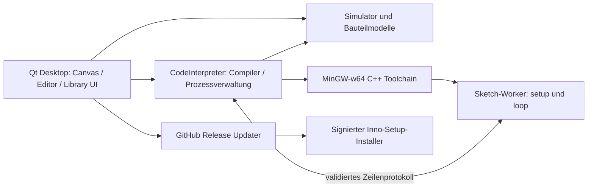

# Architekturkonzept

## Ziel und Genauigkeitsvertrag

ThinkCad ist eine native Windows-/Linux-Anwendung, keine Web-Anwendung. C++20/Qt Widgets
und `QGraphicsScene` ermöglichen einen frei gestaltbaren 2D-Arbeitsbereich sowie
angedockte Editor-, Bibliotheks- und Diagnosefenster. Das Referenzbild dient der
Anordnung; Assets, Marken und proprietäre Tinkercad-Darstellungen werden nicht übernommen.

Das Gesamtsystem hat zwei klar getrennte Ausführungsziele:

1. **Implementierter Host-API-Backend:** Arduino-kompatible C++-Syntax wird zu einer
   native Host-Executable übersetzt. Simulatoradapter liefern `Arduino.h`, `Wire` und
   eine kleine SSD1306-API. Die virtuelle Zeit zählt explizite Wartezeiten und
   modellierte I²C-Transfers. Maschineninstruktionen verbrauchen dabei keine
   simulierte Xtensa-Zeit. Unverändert nutzbar sind nur Sketches/Bibliotheken,
   die diese API-Teilmenge verwenden. Einfache globale Funktionen erhalten `.ino`-Vorwärtsdeklarationen. Komplexe
   Templates, Defaultargumente und Präprozessorfälle brauchen explizite Deklarationen.
2. **Zukünftiger Firmware-Backend:** Original ESP8266 Arduino Core mit Xtensa
   cross-kompilieren; Firmware in einem Xtensa-LX106-Backend mit ROM, Flash,
   MMIO, Interrupts, Timern und modellierten Peripheriegeräten ausführen.
   Dies ist ein erhebliches eigenes Projekt. Ein ESP32/QEMU-Backend ist kein
   automatischer Ersatz für ESP8266-Emulation. Erst mit geprüften Core-/ROM-
   und Peripheriemodellen darf volle Firmware-Kompatibilität zugesichert werden.

C++ sollte nicht mit einer selbstgeschriebenen Zeileninterpretation ausgeführt werden:
Templates, Header, Makros, Vererbung und externe Bibliotheken brauchen einen echten
Compiler bzw. eine vollständige C++-Frontend-Infrastruktur. Ein späterer Clang/LLVM-JIT
wäre ein alternatives Host-Backend, würde aber ebenfalls keine Hardware emulieren.

## Module und Abhängigkeiten



| Klasse/Modul | Verantwortung | Implementierter Pfad |
|---|---|---|
| `Component` | Identität, Lebenszyklus, virtuelle Rücksetzung | `include/thinkercad/simulation.hpp` |
| `Board` | MCU-unabhängige GPIO-Schnittstelle | dieselbe Datei |
| `Esp8266Board` | NodeMCU-Pinzuordnung, GPIO-Modi, ADC | `src/core/simulation.cpp` |
| `DigitalNet` | Digitale Treiber und Konfliktauflösung | dieselbe Datei |
| `Led` | Vorwärtsspannung, Serienwiderstand, Strom/Helligkeit | dieselbe Datei |
| `Display`, `OledDisplay` | Sichtbares Frame, Revision, Transferzeit | dieselbe Datei |
| `Frame`, `Animation` | Pixel und zeitlich geplante Framefolgen | dieselbe Datei |
| `Simulator` | Monotone Mikrosekundenzeit und Ereigniswarteschlange | dieselbe Datei |
| `CodeInterpreter` | Übersetzung, Worker-Lebenszyklus, IPC, Watchdog | `src/gui/codeinterpreter.*` |
| Arduino-/SSD1306-Adapter | Unterstützte Sketch-APIs und Frame-Protokoll | `sdk/` |
| `CircuitDocument`, `CircuitState` | Bauteile, Kabel, resistiver DC-Netzlöser, Strom und Pegel | `include/thinkercad/circuit.hpp`, `src/core/circuit.cpp` |
| `CircuitCanvas` | Pin-Auswahl, Leitungen, Verschieben, Löschen, Undo/Redo, Rendering | `src/gui/circuitcanvas.*` |
| `ExampleCatalog` | Sieben verdrahtete Referenzschaltungen und Sketch-Zuordnung | `src/gui/examples.*` |
| `SketchProject`, `ProjectIO` | Arduino-Tabs, portable JSON-Projekte, atomisches Speichern | `src/gui/projectio.*` |
| `MainWindow`, `CodeEditor` | UI, Eingänge, Syntaxfarben, Protokollvalidierung | `src/gui/` |
| `Updater` | Release-Discovery, Download, Hash, Signatur, Neustart | `src/gui/updater.*` |

Der Kern hat **keine Qt-Abhängigkeit**. Der gegenwärtige kleine GUI-Prototyp bindet
Protokoll und Modell in `MainWindow`; bei Ausbau diese Zuständigkeit in einen
`SimulationSession`-Controller ziehen. Für neue Bauteile folgen eine `ComponentRegistry`
mit Typ/Fabrik, `PinDescriptor`s, Projekt-IDs und serializers. Zunächst eingebaute
Fabriken verwenden; Plugin-ABI und fremde DLLs später isolieren und versionieren.

## Schaltung und ESP8266

NodeMCU-Zuordnung: D0→GPIO16, D1→5, D2→4, D3→0, D4→2, D5→14,
D6→12, D7→13, D8→15; RX→3, TX→1. GPIO6–11 sind für Flash reserviert
und werden zurückgewiesen. 3V3/GND erscheinen im Demo-Aufbau als feste Versorgung.
VIN wird nicht angeboten; die simulierte Versorgung ist ideal und konstant.

- Ausgänge treiben 0 oder 3,3 V; starke High/Low-Treiber am selben Netz erzeugen
  einen diagnostizierbaren Konflikt. Ein Pullup ist schwach und verliert gegen Low.
- Ein unbeschalteter Eingang bleibt explizit schwebend. `digitalRead()` auf
  schwebenden/konfliktbehafteten Eingängen stoppt diesen Prototyp mit Diagnose.
- GPIO16 akzeptiert kein `INPUT_PULLUP`; reale Spezialfunktionen/Boot-Strapping
  sind noch nicht modelliert. `digitalWrite` auf INPUT wird derzeit abgelehnt,
  anders als die Pullup-Umschaltung mancher Arduino-Cores.
- Der nackte ADC hat 0–1 V und 10 Bit. NodeMCU-Boardvarianten besitzen teils
  Widerstandsteiler; diese müssen als Boardprofil statt globaler Annahme ergänzt werden.
- Die eingebaute LED auf GPIO2 ist aktiv-low. Das unabhängige LED-Modell berechnet
  `I = max(0, (Vanode − Vkathode − Vf) / R)`; es ist ein einfaches Serienmodell,
  keine komplette Halbleiterkennlinie. Der GUI-Aufbau bietet externe LEDs mit
  separatem Vorwiderstand und diagnostiziert mehr als 20 mA.

`CircuitDocument` enthält stabile Bauteil-IDs, Pins, ideal leitende Kabel, Positionen und
Bauteilwerte. UI-Positionen ändern keine elektrische Verbindung. Undo/Redo speichert
Dokument-Snapshots. `.thinkercad`-Dateien enthalten Schaltung und eingebettete Sketch-Tabs;
`QSaveFile` schreibt atomar. Projektgröße, Komponentenanzahl, Endpunkte und relative
Quelldateinamen werden vor Übernahme validiert. Gedrückte Taster sind ein flüchtiger Eingang.

Der DC-Netzlöser verbindet Kabel und geschlossene Taster mit Union-Find und löst
verankerte resistive Netzwerke per Gauß-Elimination. Unbeschaltete Netzwerke bleiben
schwebend. GPIO-Pullups werden mit 47 kΩ, OLED-SDA/SCL-Pullups mit 4,7 kΩ modelliert.
LEDs verwenden eine stückweise lineare Kennlinie mit 2 V Vorwärtsspannung und 10 Ω
dynamischem Widerstand; die aktive Menge wird iteriert. Das Modell eignet sich für
einfache LED-/Widerstandsschaltungen und ist kein allgemeiner nichtlinearer SPICE-Solver.
Netze ohne Spannungsreferenz, widersprüchliche ideale Quellen und ausbleibende
LED-Konvergenz werden explizit behandelt. Kapazitäten, Transienten, GPIO-Ausgangsimpedanz
und beliebige komplexe Diodennetze bleiben Ausbauarbeit.

Ein OLED bestätigt `begin()` nur bei gültiger Versorgung, Masse, SDA/SCL-Verkabelung,
getrennten Busleitungen, High-Idle-Pegeln und eindeutiger I²C-Adresse. Frame-Nachrichten
tragen die Zieladresse, damit mehrere Displays zugeordnet werden können.

## Zeit und Display

`Simulator` sortiert Ereignisse nach `(Mikrosekunden, Einfügereihenfolge)`. Damit
sind gleiche Zeitstempel reproduzierbar. Ereignisse dürfen weitere Ereignisse
planen; ein Budget verhindert endlose Ereignisketten ohne Zeitfortschritt.
Callbacks sollen Modelle verändern, ohne GUI-Zeiger zu halten. Besitzer von Displays
müssen länger leben als ihre geplanten Callbacks. `Animation` kopiert Frames in
Callbacks; diese überleben deshalb das Animation-Objekt.

Der OLED hat getrennte Sketch-Zeichenpuffer und sichtbare Host-Frames. Erst
`display.display()` veröffentlicht den Puffer nach der Transferdauer:

```
Zeit = ceil((Adresse + Steuerbyte + 1024 Datenbytes) × 9 × 1_000_000 / I2C_Hz)
400 kHz: 23_085 µs → theoretisch höchstens etwa 43 vollständige Frames/s
100 kHz: 92_340 µs → theoretisch höchstens etwa 10,8 vollständige Frames/s
```

Dies ist ein nachvollziehbares **vereinfachtes** Transfermodell: START/STOP,
zusätzliche SSD1306-Kommandos, Paketaufteilung der echten Library und elektrische
Rise-Times fehlen noch. Der aktuelle Adapter übergibt fertige Bilder direkt;
er decodiert noch keine beliebigen echten SSD1306-I²C-Kommandos. Deshalb funktioniert
die upstream-Adafruit-Bibliothek nicht allein durch Hinzufügen ihres Ordners.

`drawBitmap` liest row-major, MSB-first und gepaddete Zeilen. Der SSD1306-Puffer und
IPC-Transport verwenden dagegen Page-Layout: `x + (y / 8) * 128`, Bit `y % 8`.
Die GUI übersetzt dies in `Frame`-Pixel. Bildimport erzeugt das row-major Layout.
Eine Animation kann aus globalen `PROGMEM`-Arrays bestehen oder mit `Animation`
und `Simulator` direkt geplant werden. Frame-Dauer und Transferzeit sind ausdrücklich
zu unterscheiden; 77 ms Pause plus 23,085 ms Transfer ergeben etwa 10 FPS.

Ein **LCD1602** ist ein anderes Modell: 16×2 Zeichenzellen, HD44780-DDRAM/CGRAM,
meist acht benutzerdefinierte 5×8-Zeichen, ggf. PCF8574-I²C-Expander. Es eignet sich
für Text und kleine Glyphenanimationen, nicht für 128×64-Videoframes. Deshalb startet
diese Implementierung mit SSD1306. HD44780/PCF8574 benötigen eigene Komponenten.

## Sketch-Ausführung

1. Die `.ino`-Tabs werden kombiniert; einfache Funktionsprototypen werden ergänzt.
   Die aktuellen Tabs, Header und lokalen C++-Quellen werden in ein temporäres Verzeichnis geschrieben.
2. `g++ -std=c++20` kompiliert `sdk/runner.cpp`, den eingebundenen Sketch und
   portable Bibliotheksquellen. Argumente werden ohne Shell übergeben.
3. Der Runner ruft `setup()` genau einmal auf und danach `loop()` wiederholt.
4. Arduino-Aufrufe erzeugen validierte Nachrichten `MODE`, `WRITE`, `READ`,
   `ADC`, `I2C`, `OLED_BEGIN`, `TIME`, `FRAME`. Interne `SPEED`-Anfragen beantwortet
   `CodeInterpreter` direkt mit dem aktuellen Tempo in Tausendsteln. Eingabelesen wartet auf eine Host-Antwort.
5. Virtuelle `delay()`/I²C-Zeit wird in Abschnitten an den Host gemeldet.
   Ein Abschnitt entspricht höchstens etwa 50 ms realer Wartezeit beim aktuellen
   Tempo (0,1× bis 10×). Der Worker fragt das Tempo für jeden Abschnitt neu ab;
   virtuelle Zeitstempel bleiben unverändert. GUI-Rendering und Compiler sind asynchron;
   reale Betriebssystemlatenz verändert keine protokollierten Zeitstempel.
6. Stop beendet den eigenen Worker. Watchdog: 120 s Compile-Limit, 10 s ohne
   Protokollaktivität; Puffer/Zeilen-/Ratenlimits verhindern GUI-Überlastung.

Ein separater Prozess schützt vor einem Sketch-Absturz und erlaubt Abbruch, ist aber
**keine Sicherheitssandbox**: Sketches und Libraries können auf Dateien, Prozesse
und Netzwerk zugreifen. Eine produktive Ausführung fremden Codes braucht Windows
Job Objects mit Speicher-/CPU-Limits, eingeschränkte Tokens/AppContainer, kontrollierte
Handles/IPC und einen eingeschränkten Compile-Worker. Die Protokollparsergrenzen
verhindern außerdem nicht alle Ressourcenangriffe des Workers.

Für Ausbau: ein versioniertes, längenbegrenztes binäres IPC-Protokoll mit Session-ID,
`SimulationBackend`-Interface (start/stop/read/write/advance), reinem
`SimulationSession`-Controller, strukturierten Compilerdiagnosen und deterministischem
Replay. Erst danach PWM, Interrupts, SPI, UART und Firmware-Backend hinzufügen.

## Flash-Adapter

`sdk/pgmspace.h` und der AVR-Includepfad bilden Flash-Lesezugriffe auf normalen
Prozessspeicher ab. `PROGMEM` und `ICACHE_RODATA_ATTR` sind hostseitig leer; Sketches
und Projekt-Exporte behalten sie. Typisierte Reads verwenden `memcpy` und tolerieren
unaligned Adressen. Pointertabellen verwenden die volle Host-Pointerbreite; Flash-Words
und Dwords behalten 16 bzw. 32 Bit. `F` und `PSTR` liefern normale String-Literale.
Das Compile-Define `THINKERCAD_SIMULATION=1` gilt für Sketch und lokale/externe Quellen,
um weitere Hardwareblöcke explizit konditional zu behandeln. Flash-Controller,
Schreibzyklen, Dateisysteme und ESP-Instruktionen werden damit nicht emuliert.

## Bibliotheken

Der Manager lädt den offiziellen Arduino-Bibliotheksindex und installiert SHA-256-geprüfte
ZIPs in versionierte Nutzerverzeichnisse; aktive Pfade stehen in `QSettings`. Moderne `src/`-
Bibliotheken und ältere Root/`utility`-Layouts werden beim Build eingebunden.
Das SDK steht vor externen Includes; bekannte Simulatoradapter werden nicht durch
upstream-Header überschrieben. Dies ist eine explizite Kompatibilitätsentscheidung.

Versions-/Abhängigkeitsauflösung, ZIP-Path-Traversal-Schutz und Hashprüfung sind
implementiert. Architekturen werden angezeigt; ein Projekt-Lockmanifest fehlt noch. Für hardwarenahe Libraries ist zusätzlich
zu erfolgreicher Kompilierung ein passendes Register-/Busmodell nötig.

## Windows-Auslieferung und Updates

Inno Setup installiert per-user. Qt wird dynamisch deployt; die UCRT64-GCC-Toolchain
wird für Sketch-Kompilierung mitgeliefert. Build-/Distributionslizenzen, Größe und
Signierinfrastruktur sind eigenständige Release-Anforderungen.

Updater-Ablauf:

1. Neueste stabile GitHub-Release-Version mit der eingebauten SemVer vergleichen.
2. Passenden Installer und exakt zugeordnetes SHA-256-Asset laden.
3. Größenlimits, HTTPS und Zielhost prüfen; TLS-Prüfung bleibt aktiv.
4. Hash vergleichen und mit dem gebündelten GitHub-CLI-Verifier die Sigstore-
   Attestierung gegen Repository, Workflow, `refs/heads/main` und Quellcommit prüfen.
   Bundle und Vertrauenswurzeln erlauben Prüfung ohne GitHub-Anmeldung.
5. Die atomar abgelegte, geprüfte Update-Datei bereitstellen.
6. Vor dem Neustart ungespeicherte Projekte behandeln. Ein nativer Helfer wartet
   auf das Prozessende, prüft die Attestierung erneut und startet Inno Setup.
   Der Installer ersetzt Dateien und startet ThinkCad anschließend wieder.

Ein Herausgeberzertifikat ist für diesen Ablauf nicht erforderlich; Authenticode
kann zusätzlich aktiviert werden. Windows CI prüft gültige Attestierungen sowie
falsche Commits, manipulierte Installer und ungültige Bundles. Installerstart und
Deinstallation sind separate Windows-Tests. Unterbrechung, Rollback und die vollständige
Update-Interaktion brauchen weitere End-to-End-Prüfungen. Clients bis 0.3.0 brauchen
einen manuellen ersten Wechsel, weil ihr Updater ohne Zertifikat deaktiviert war.

## Ausbau in prüfbaren Etappen

| Etappe | Ergebnis | Abnahmekriterium |
|---|---|---|
| A – dieser Stand | GPIO-/Zeitkern, OLED-Animation, Qt-Prototyp | Kern und GUI-Smoke bestehen |
| B – 0.2.0 | `CircuitDocument`, freie Netze, LED/Widerstand/Taster, Projektdateien | Edit/Undo/Save/Load erhält Netlist; Kurzschluss wird erkannt |
| C | I²C-Busmodell, SSD1306-Decoder, HD44780/PCF8574, Library-Pakete | Referenzsketches gegen echte kompatible Libraries |
| D | PWM, Interrupts, SPI, UART, dynamischer analoger Netzlöser | Messbare Frequenzen, Pegel und Schaltvorgänge |
| E | begrenzte Worker, gehärtete Installer/Updater | Windows-Sicherheits-/Update-/Uninstall-Tests |
| F | originaler ESP8266-Firmware-Backend | dokumentierte CPU-/Peripherie-Konformitätstests |

Die Module können unabhängig wachsen; volle ESP8266-Kompatibilität ist erst nach
Etappe F belastbar. Die gegenwärtige Ausführung ist eine nützliche, getestete Grundlage,
keine Behauptung eines bereits vollständigen Tinkercad-Ersatzes.

## Mehrere Boards seit 0.5.3

`MainWindow::BoardRuntime` besitzt pro Board eine eigene GPIO-/ADC-Instanz,
virtuelle Uhr, I²C-Pinzuordnung, Display-Bindungen und einen `CodeInterpreter`.
Ein gemeinsamer Start wartet auf die erfolgreiche Kompilierung aller Sketches;
jedes Board führt anschließend seinen Sketch in einem eigenen Prozess aus.
`CircuitDocument::solve` erhält die Board-Instanzen gemeinsam und löst damit
auch boardübergreifende GPIO-Netze und widersprüchliche Ausgangstreiber.
Ein Fehler stoppt alle Prozesse. Die Betriebssystem-Zeitsteuerung bietet keine
zyklengenaue Synchronisation, Interrupt- oder Busarbitrierungs-Emulation.

`SavedProject::boardSketches` speichert die Programme nach stabiler Board-ID.
Projektformat 2 enthält weiterhin einen primären Sketch und zusätzlich die
Board-Sketches; der Loader validiert die Dateien und Board-Zuordnungen.
Alte Projekte werden dem vorher ausgewählten Board zugeordnet. Die Auswahl im
Code-Editor wechselt nur die angezeigte Quelle und beeinflusst laufende Boards nicht.
