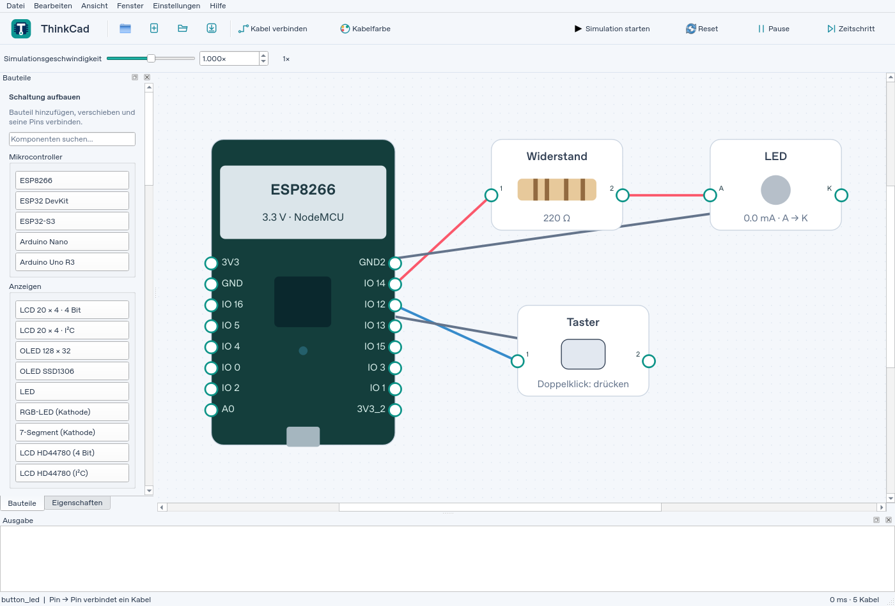
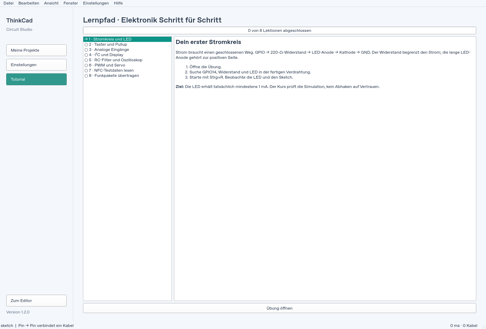
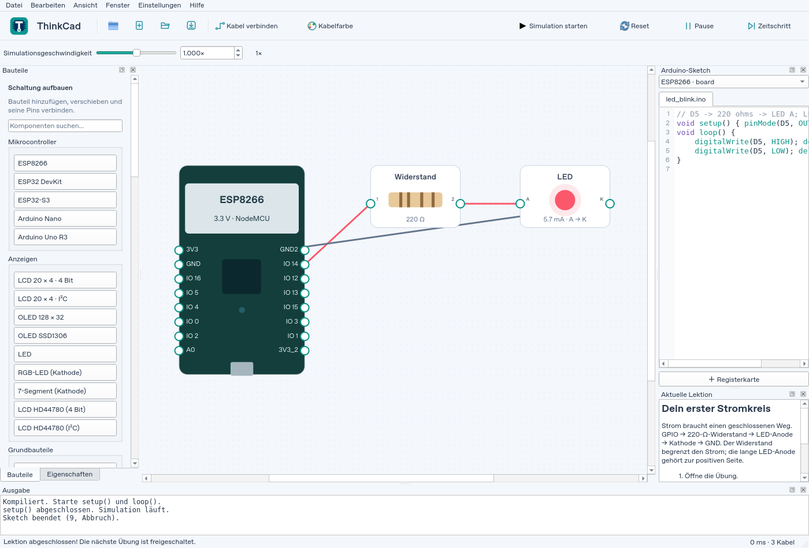
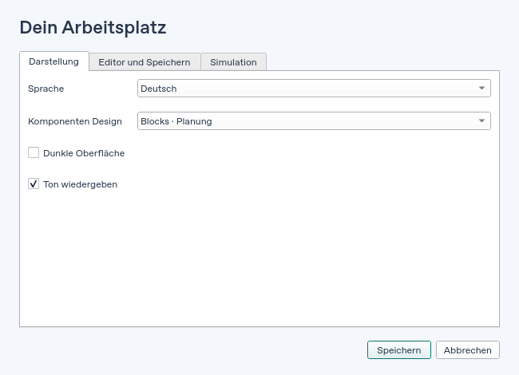
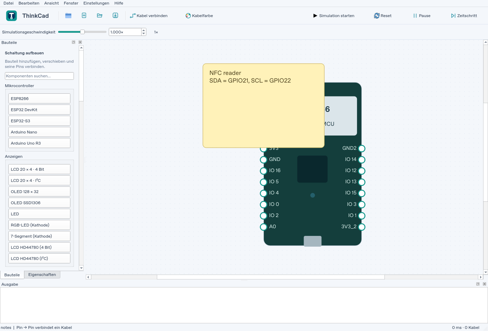
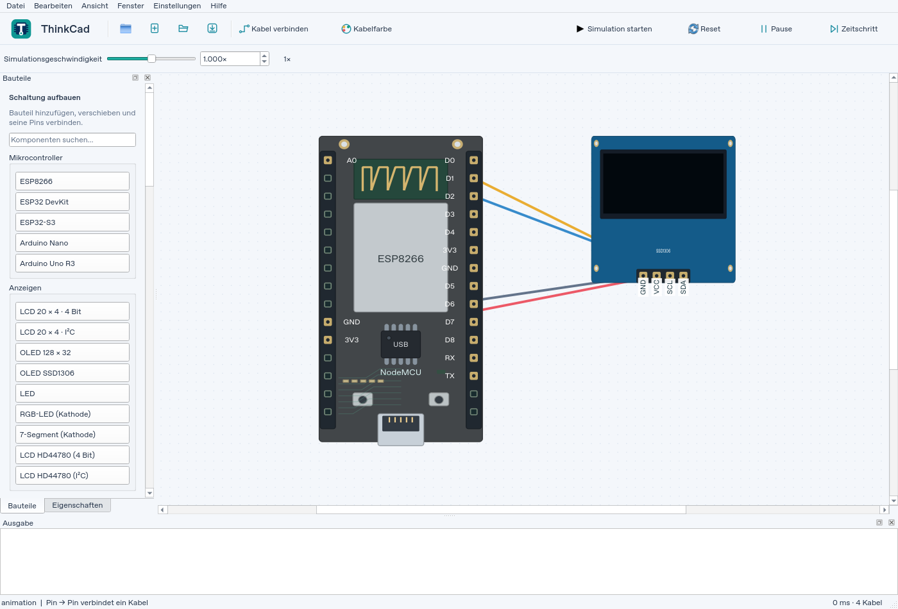

# ThinkCad 1.2.0 – visuelle Prüfung

Echte Screenshots der Qt-Anwendung auf Linux, keine UI-Entwürfe.

## Arbeitsbereich und Geschwindigkeit

Flache Werkzeuge, neue Dateisymbole und direkt eingebbare Simulationsgeschwindigkeit.
Die Bauteilpalette bleibt nach Auswahl und Platzierung geöffnet.

## Lernkurs

Acht Lektionen mit gespeichertem Fortschritt. Übungen werden erst nach Erreichen
der Ziele freigeschaltet; eine laufende Übung behält ihre Anleitung.

## Einstellungen

Darstellung, Editor/Speichern und Simulation sind in Tabs gegliedert.

## Notizen und Pinbeschriftungen

Notizen werden auf der Arbeitsfläche platziert und im Projekt gespeichert.
SSD1306 zeigt GND, VCC, SCL und SDA auch in der Realistic-Ansicht.

Automatisches lokales Speichern läuft alle 60 Sekunden für bereits benannte
Projekte. Die AppImage-Aktualisierung wird zusätzlich auf Byte-Integrität und
erhaltende Fehlerfälle geprüft. Details stehen in der [AppImage-Anleitung](APPIMAGE.de.md).
