# ThinkCad 1.0.0: visueller Funktionsrundgang

Dieser Funktionsrundgang dokumentiert die vor der Veröffentlichung aufgenommenen
Screenshots für Version 1.0.0. Die Bilder stammen aus der tatsächlich laufenden
Qt-Anwendung auf Linux (Offscreen-Plattform), nicht aus Entwürfen.
Native Windows- und Gentoo-Darstellung sowie echte USB-Geräte müssen noch auf den
Zielsystemen geprüft werden. Die vollständige Bedienung steht im
[deutschen Handbuch](V1_GUIDE.de.md) und im [englischen Handbuch](V1_GUIDE.en.md).

## Übersicht und Analogsimulation

Arbeitsbereich mit verdrahtetem RC-Tiefpass, Live-Kurven, Messwerten und Pause.
Die Analogsimulation benötigt keinen Mikrocontroller oder Sketch-Compiler.

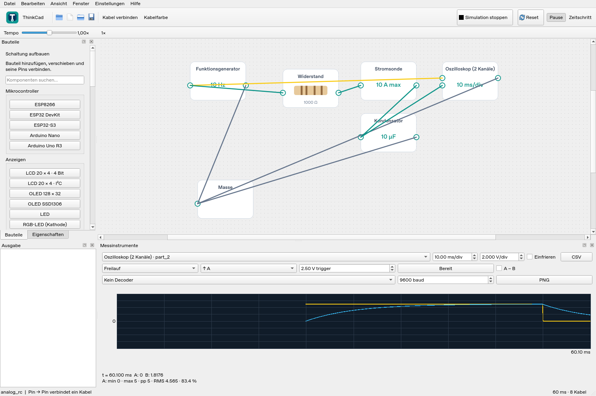

Trigger Auto/Normal/Single, Flanke und Pegel, A−B, Einfrieren, Zeit-/Spannungscursor,
Messwerte sowie CSV- und PNG-Export sind im Instrumentendock erreichbar.

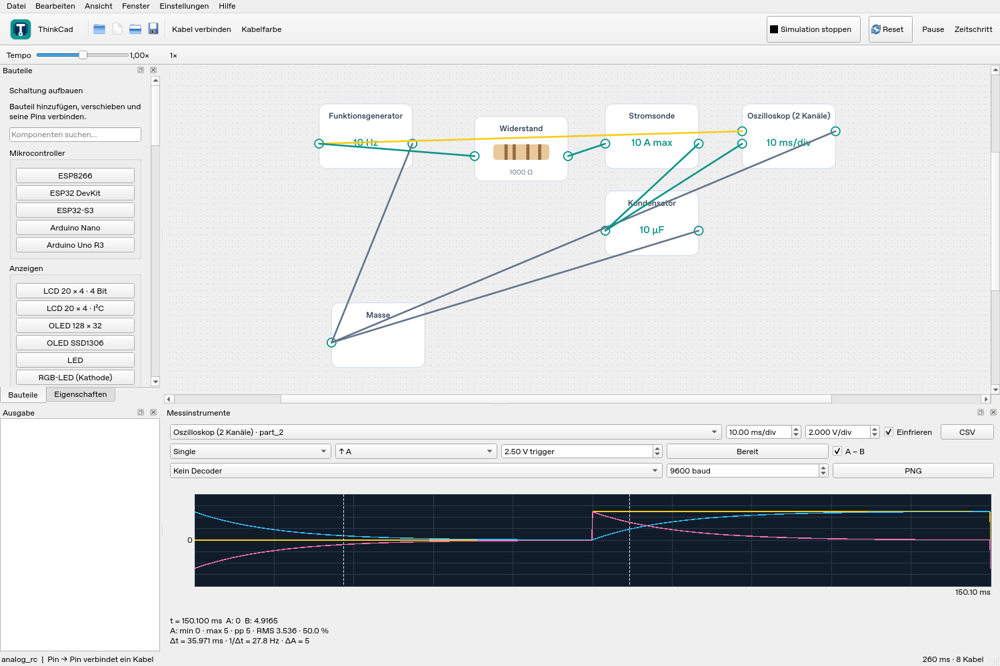

Funktionsgenerator mit Wellenform, Amplitude, Offset und Tastgrad. Bauteilwerte
stehen jetzt in einem eigenen Eigenschaften-Dock, nicht unter der gesamten Palette.

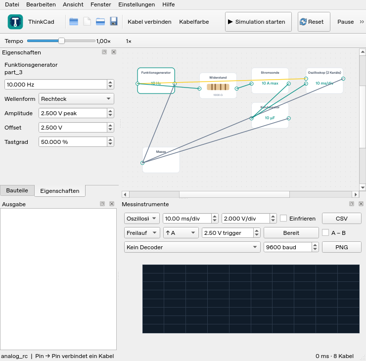

## Editor

Kopieren/Ausschneiden/Einfügen, Duplizieren, Ausrichten/Verteilen und einstellbares
Raster mit Alt-Ausnahme. Beim Kopieren werden innere Kabel/Knicke und Board-
Sketches übernommen. Die Undo-/Redo-Prüfung umfasst auch Einfügen und Abzweigungen.

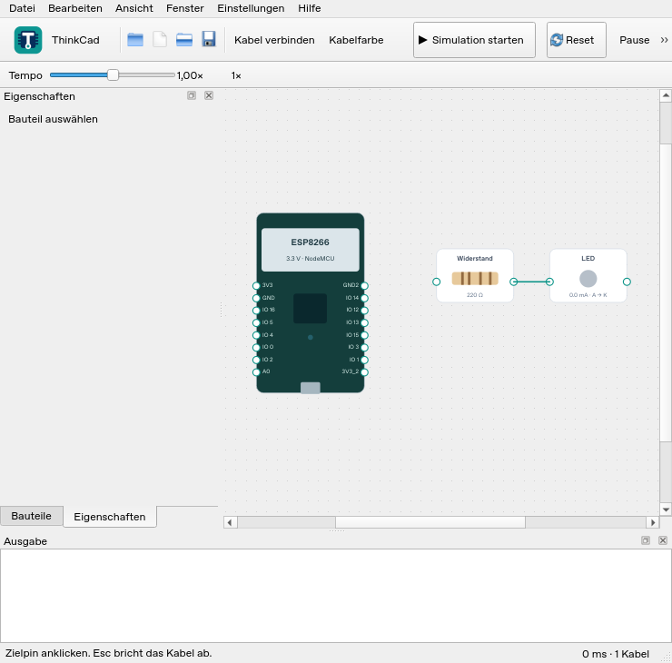

Explizite Kabelabzweigungen und elektrisch wirksame, benannte Netze. Kreuzungen
werden ohne Verbindungspunkt nicht automatisch verbunden.

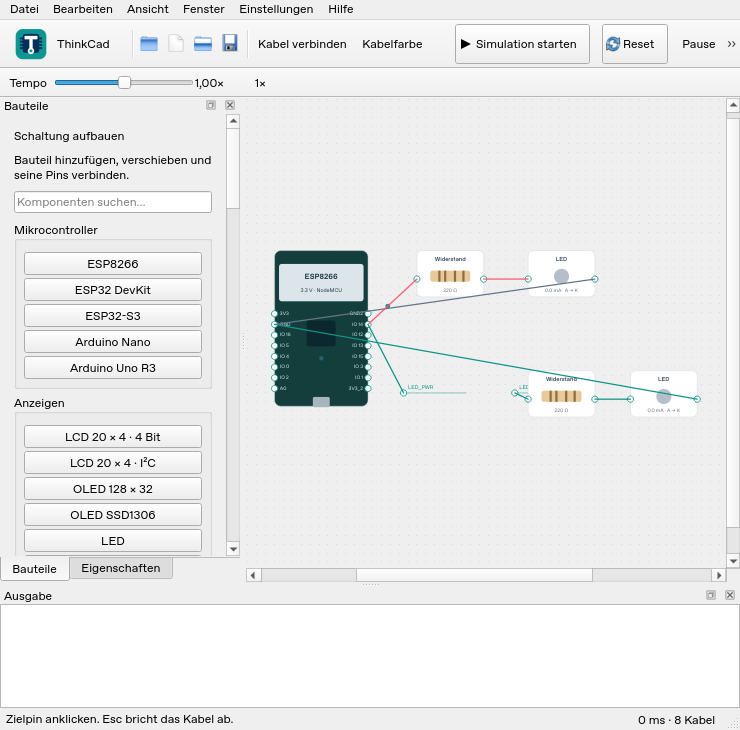

Rechtsklick auf einen Pin → Netz hervorheben markiert dessen zusammenhängende Kabel.

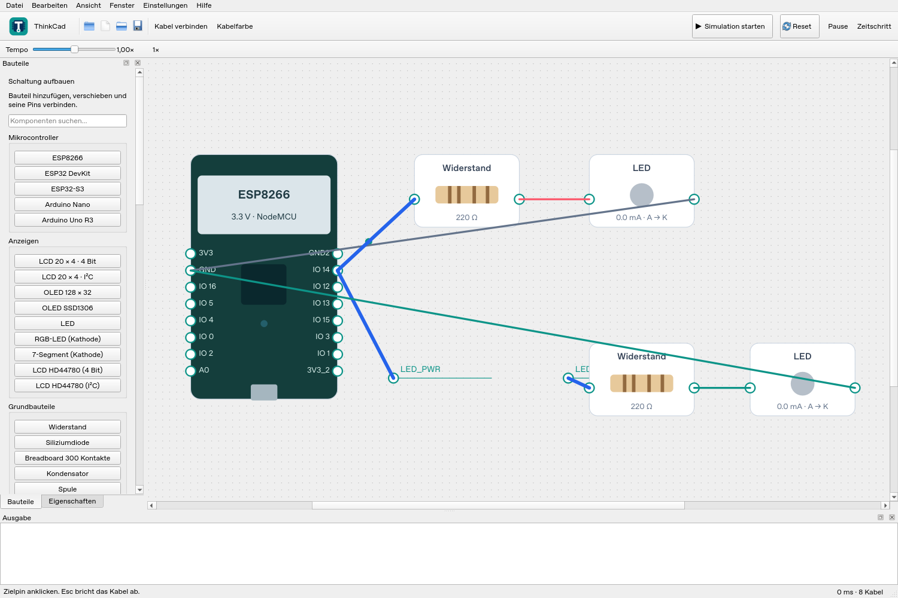

## LCDs

16×2 mit LiquidCrystal und geprüfter 4-Bit-Verdrahtung.

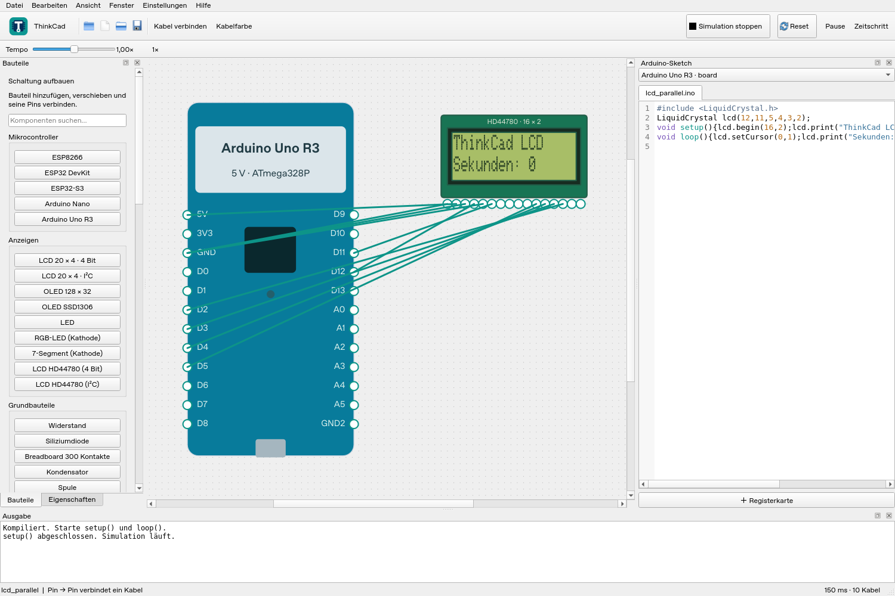

20×4 mit LiquidCrystal_I2C, Adresse 0x27, Text und eigenem 5×8-Zeichen.

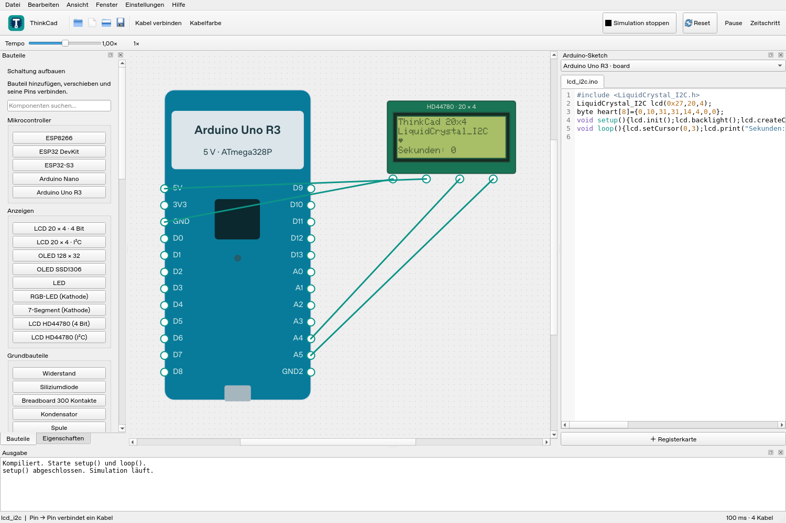

Die LCDs sind API-Adapter mit Verdrahtungsprüfung, keine taktgenaue
HD44780-/PCF8574-Registeremulation. Details und Anschlüsse stehen im Handbuch.

## Logikanalysator und Aktoren

UART-Dekodierung eines vom Sketch tatsächlich ausgegebenen 0x55-Bitmusters.
Weitere Decoder: SPI mit steigender Flanke/MSB und I²C mit ACK/NACK.

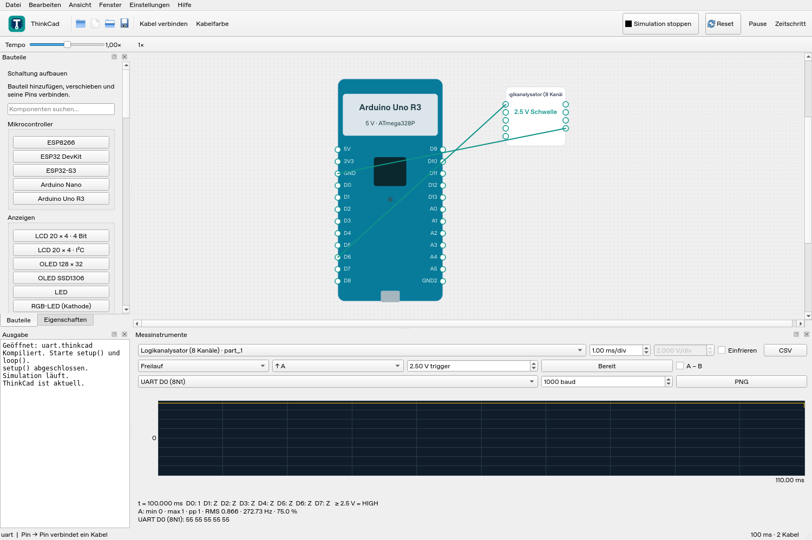

Servo.h erzeugt PWM-Pulse; das Servo-Modell zeigt den gemessenen Winkel.

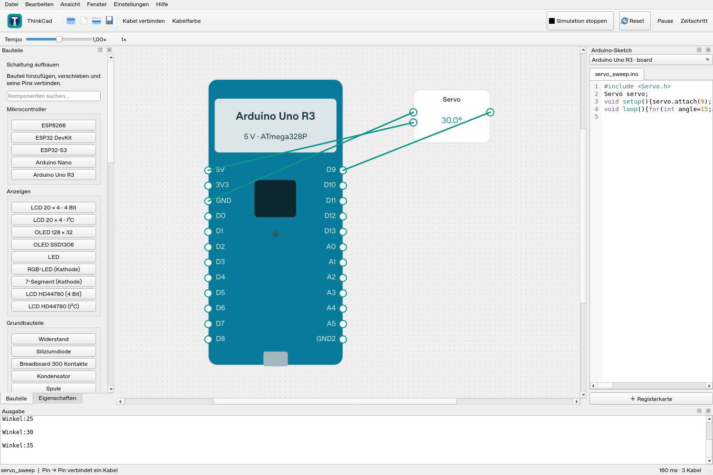

DC-Motor mit Ankerstrom, Induktivität, Gegen-EMK und mechanischem Anlauf.

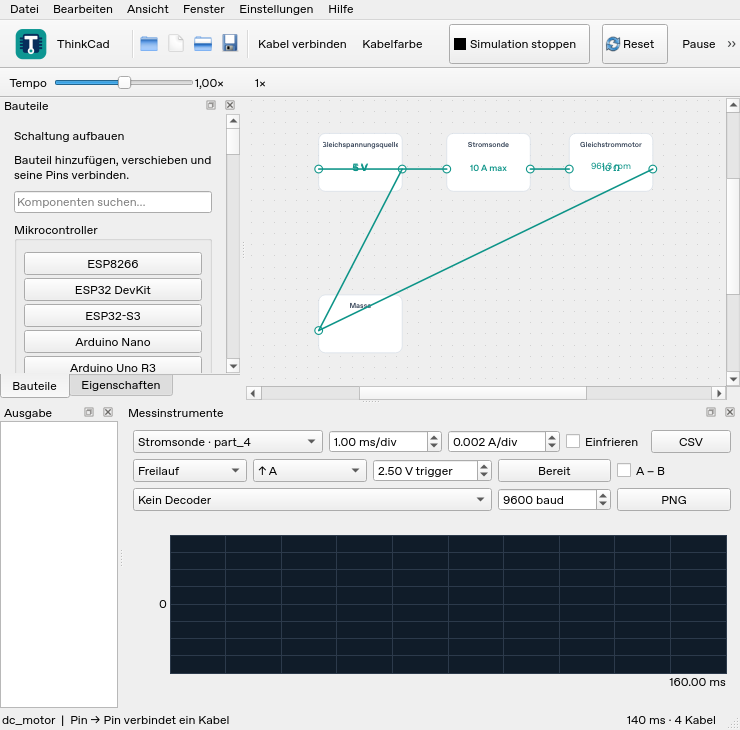

AND/NAND/OR/NOR/XOR/XNOR/NOT sind versorgte generische Gatter. Die Wahrheitstabellen
und die Ansteuerung aus einem analogen Transistornetz sind automatisiert geprüft.

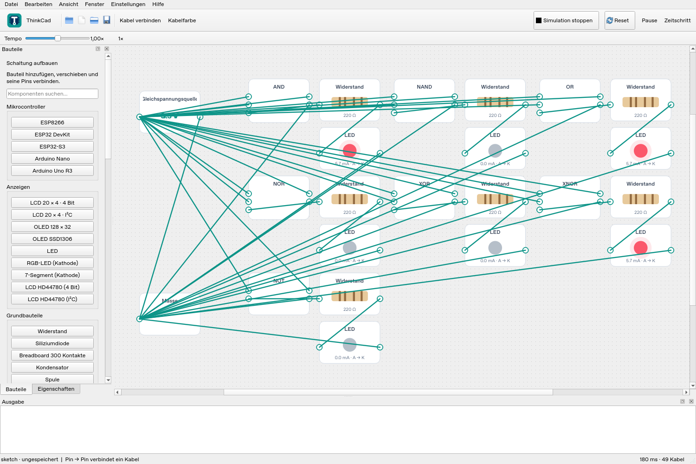

## Serieller Monitor und Plotter

Echte Ports oder simulierte Boards auswählen, Baudrate und Zeilenende einstellen,
Text senden. Simulierte Serial-Eingaben werden über available/read/peek gelesen.
Diese beiden Detailbilder verwenden ausdrücklich Demo-Zahlen aus dem UI-Test;
sie sind keine Messung eines angeschlossenen Hardwaregeräts.

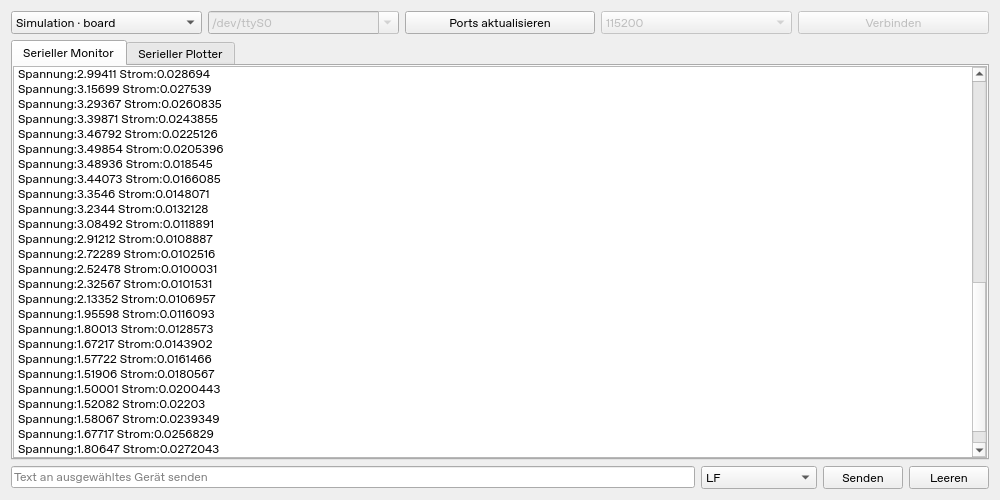

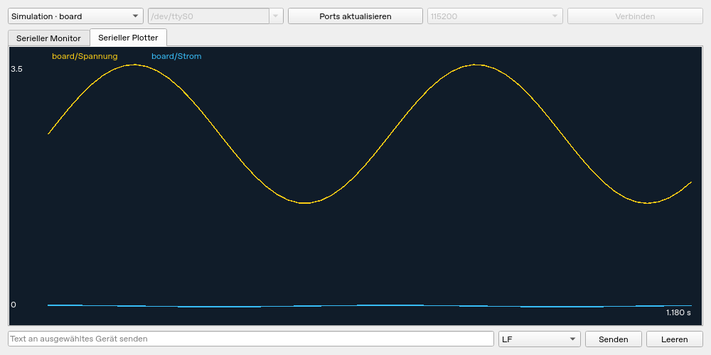

## Hardware bauen und hochladen

Arduino CLI, FQBN und Port auswählen. Der komplette Sketch wird mit realen Board-
Bibliotheken kompiliert. Der Screenshot darunter zeigt einen erfolgreichen echten
AVR-Build; die Freigabe zum Hochladen erfolgt anschließend über den Upload-Knopf.

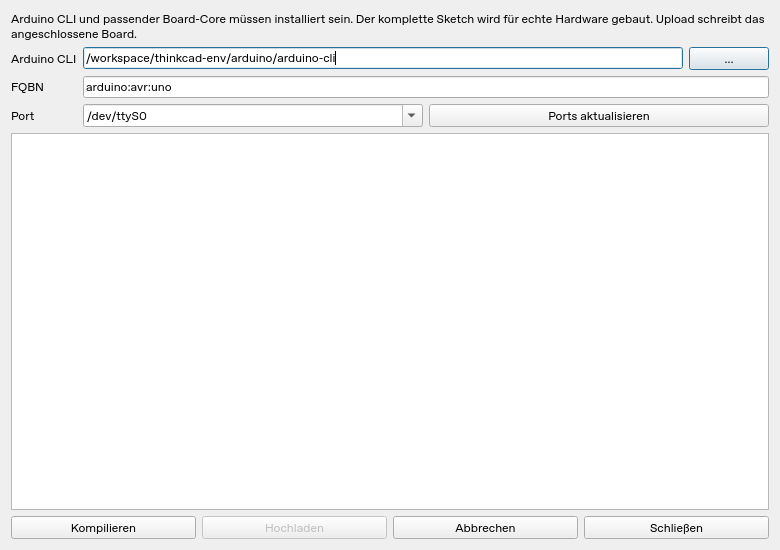

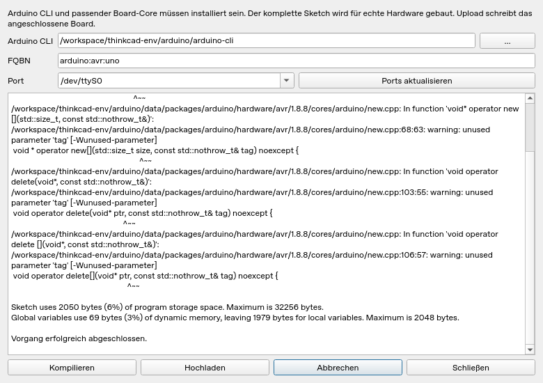

Tatsächlich geprüft: Arduino CLI 1.5.1, Arduino AVR Boards 1.8.8, LiquidCrystal
1.0.7, LiquidCrystal I2C 1.1.2 und Servo 1.3.0. Parallel-LCD, I²C-LCD und Servo
wurden für Uno kompiliert. Der Upload-Prozess und seine Argumente sind zusätzlich
mit einem Testprozess geprüft; **kein physisches Board wurde hier geflasht**.

## Zuverlässigkeit und Projektweitergabe

Alle 15 Sekunden separate Autosave-Snapshots. Wiederherstellung zeigt nur
beendete Sitzungen und öffnet eine ungespeicherte Kopie. Speichern/Verwerfen
räumt die eigene Sicherung auf; die Ursprungsdatei bleibt erhalten.

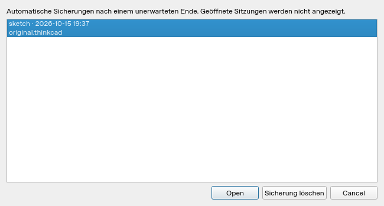

Portable Projekte enthalten Bibliotheksdateien, Versionen aus library.properties
und SHA-256-Prüfsummen. Dateinamen, Pfade, Datenmenge und Prüfsummen werden geprüft.
Hier wird eine ausdrücklich für den Test erzeugte Beispielbibliothek angezeigt.
Projektformat 3 kann Projekte der Formate 1 und 2 weiterhin öffnen.

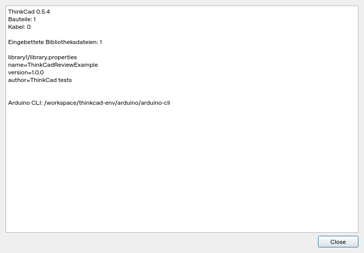

Elektrische Prüfung mit komponentenbezogenen Warnungen und einstellbarer
Widerstandsbelastbarkeit. GPIO-Überstrom wird jetzt auch bei Motoren und anderen
Lasten geprüft, nicht nur bei Lautsprechern. Warnungen modellieren keine Erwärmung.

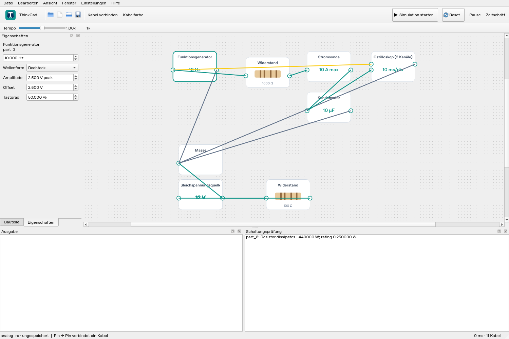

Datei → Stückliste exportiert eine CSV mit Referenz, Typ, Wert, Einheit, Modell
und Anzahl. Die Exportfunktion ist eine Datenausgabe und hat keine eigene
Layout-Ansicht. CAD-Footprints/PCB-Daten sind nicht enthalten.

## Sprache und Offline-Hilfe

Die neuen Bedienelemente stehen auf Deutsch und Englisch bereit. Das Handbuch
wird mitinstalliert und lässt sich ohne Internet öffnen.

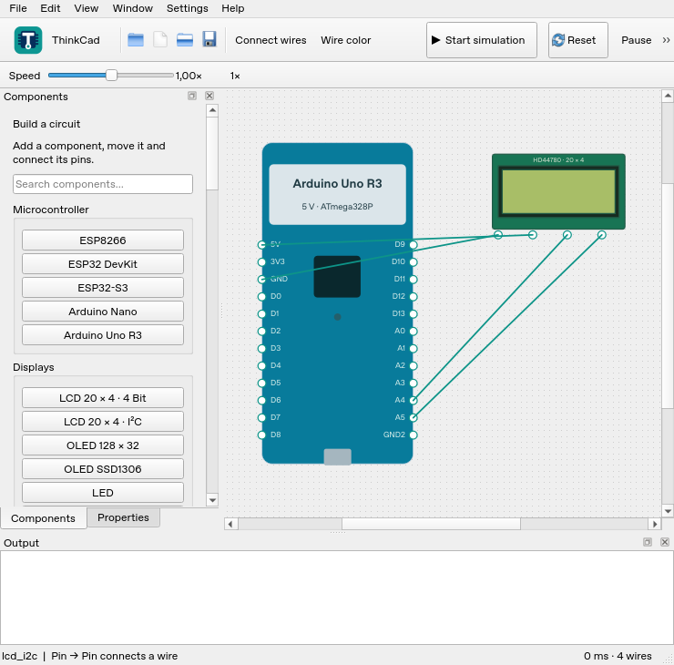

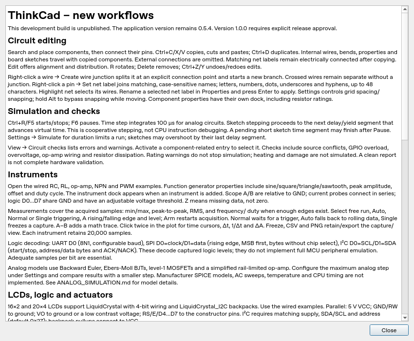

## Vor einer Freigabe noch auf euren Rechnern prüfen

- Gentoo: aus dem Quellpaket bauen, Projekte öffnen, Audio und tty-Zugriff testen.
- Windows: nativen Build starten, DPI/Schriftgrößen, COM-Erkennung und USB-Treiber prüfen.
- Auf einem echten Board: kompletten Sketch kompilieren, richtigen Port wählen,
  hochladen und anschließend Monitor/Plotter benutzen.
- Vorhandene eigene Projekte öffnen; Exportpaket auf dem anderen Rechner laden.
- Autosave/Wiederherstellung, Undo/Redo, LCD-Pins und typische Fehlverdrahtungen ausprobieren.

CPU-/Firmwareemulation, vollständige Timer/Interrupts/UART/SPI/I²C-Peripherie,
Debugger-Breakpoints/Variablen, KiCad-/PCB-Editor, Encoder, Ultraschall und
adressierbare LEDs bleiben weitere Ausbaustufen. Dieser Arbeitsstand enthält
keine vollständige SPICE-Engine und keine Hersteller-Modellbibliothek.

## IR, NFC und Funk: neue Versuche

Alle Bilder zeigen die tatsächlich laufenden, verdrahteten Beispiele. Zu jedem
Versuch gibt es Blocks und die flache Realistic-Ansicht. Alle acht Bauteile sind
auch über die gemeinsame Komponentensuche erreichbar.

NEC-TV-Fernbedienung mit 38-kHz-Empfänger: Doppelklick/Checkbox sendet 0x45;
Adresse, Kommando und Testgruppe sind einstellbar.

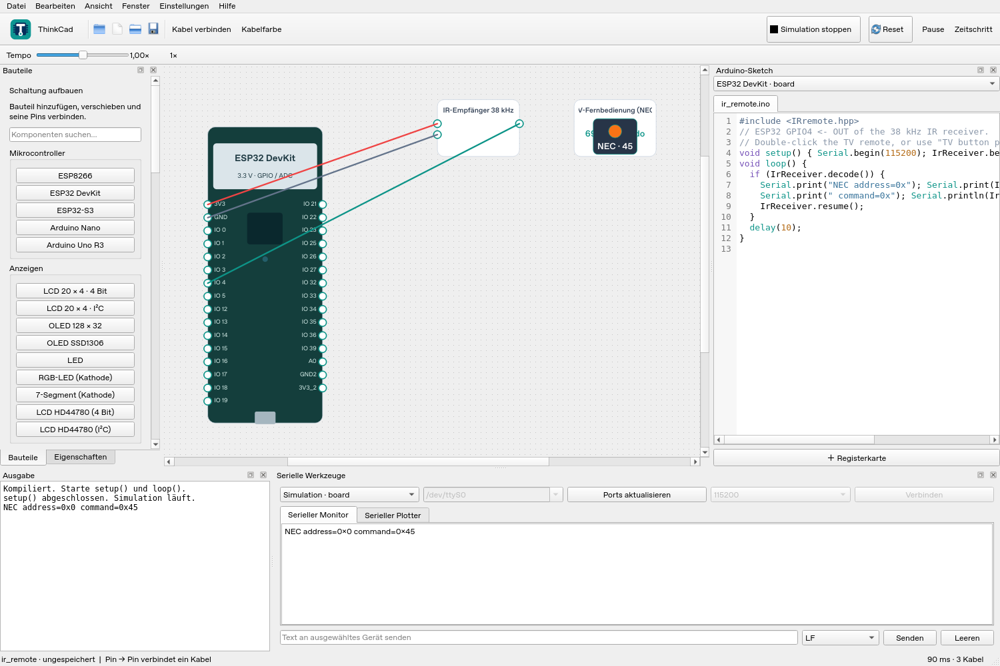
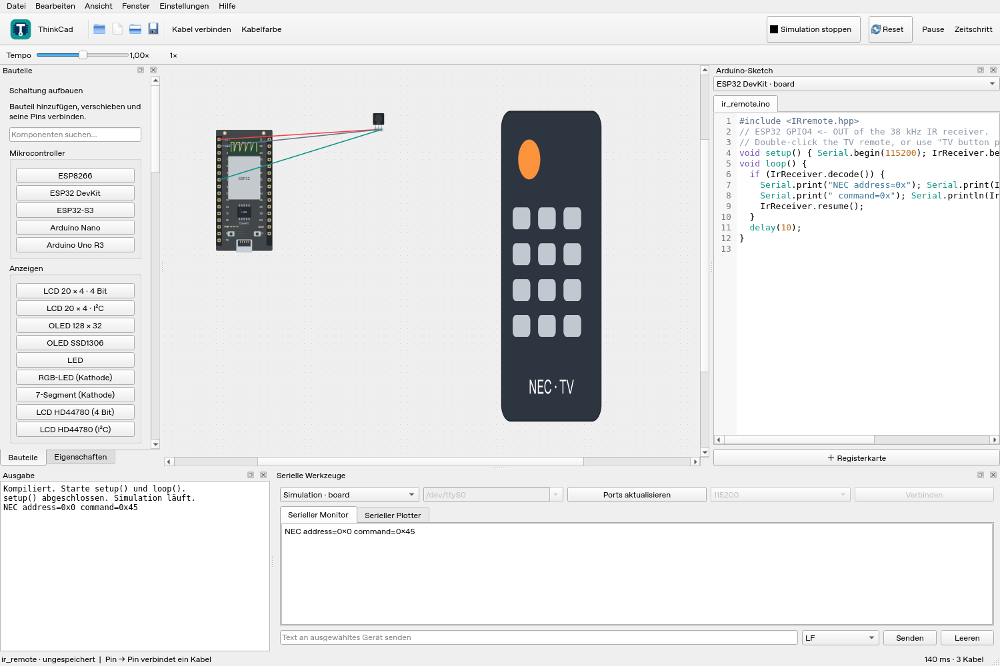

IR-LED über 220 Ω an ESP32 GPIO2; Empfänger an GPIO4. Die serielle Ausgabe
bestätigt das empfangene NEC-Kommando.

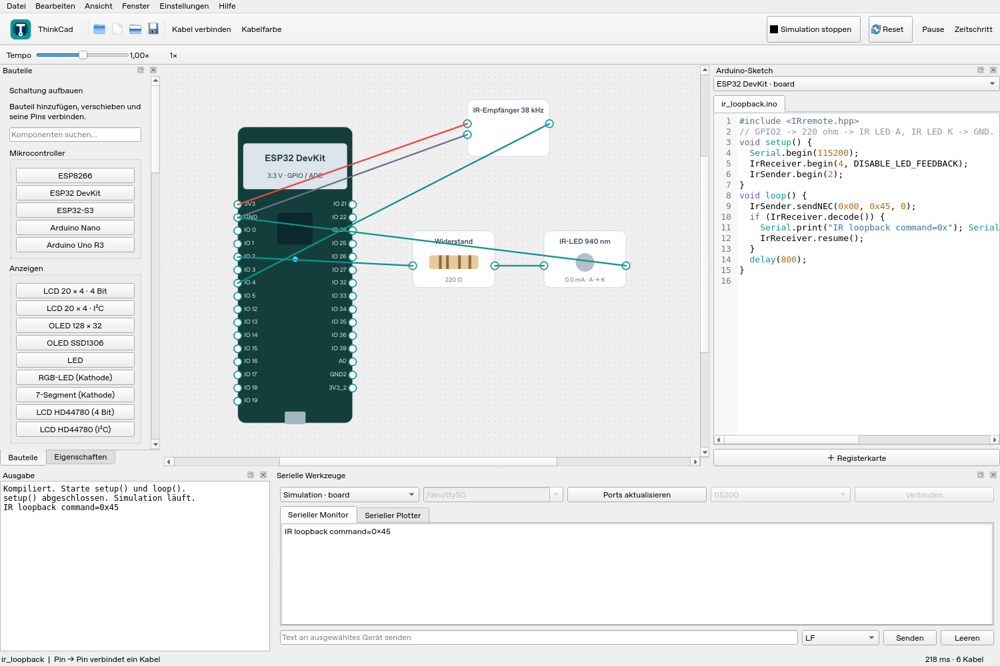
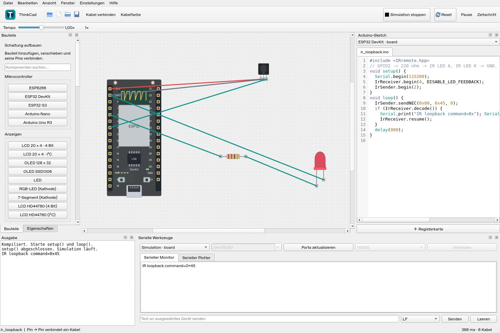

PN532 an I²C mit IRQ/RST und kreditkartenförmigem synthetischen UID-/NDEF-Tag.
Entfernen/Präsentieren ist während des Laufs möglich. Keine EMV-Zahlungskarte.

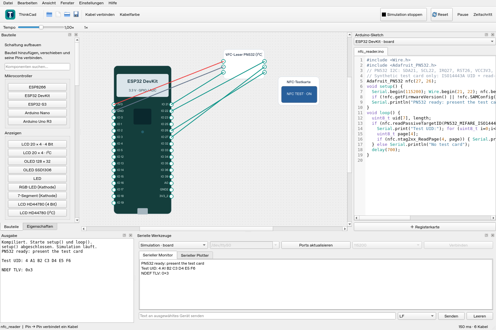
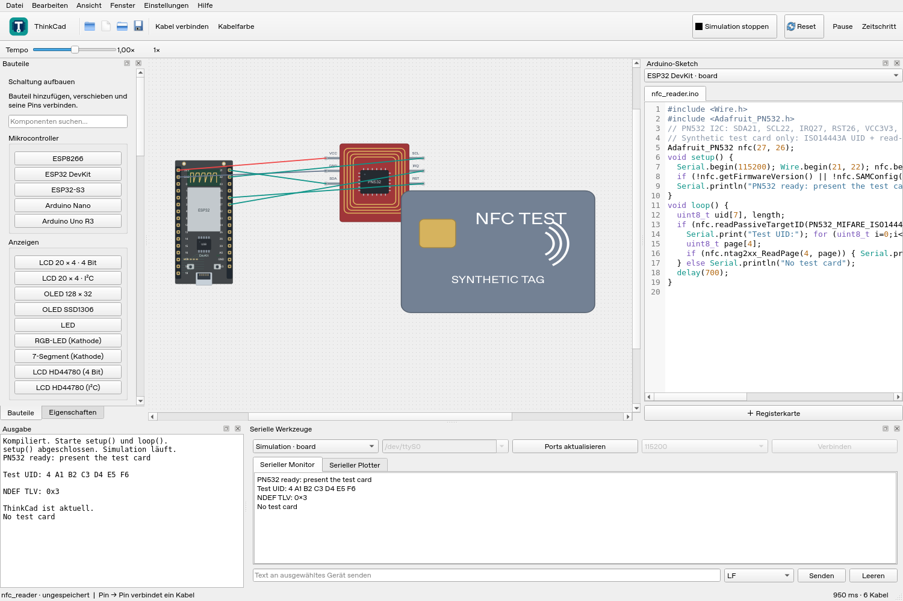

Zwei ESP32 mit eigenen Sketches und nRF24L01+ an SPI. Der Monitor zeigt
Bestätigung beim Sender und den empfangenen Text beim Empfänger.

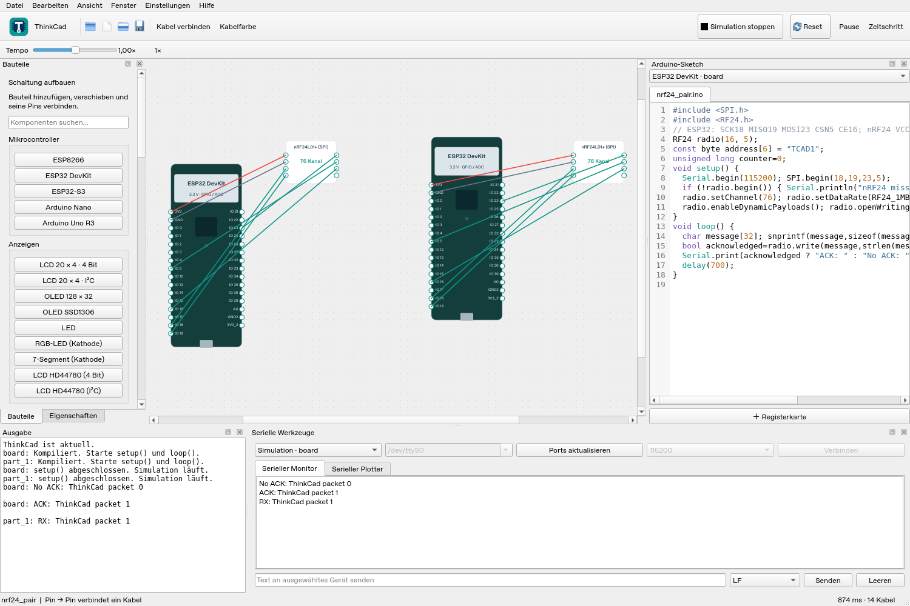
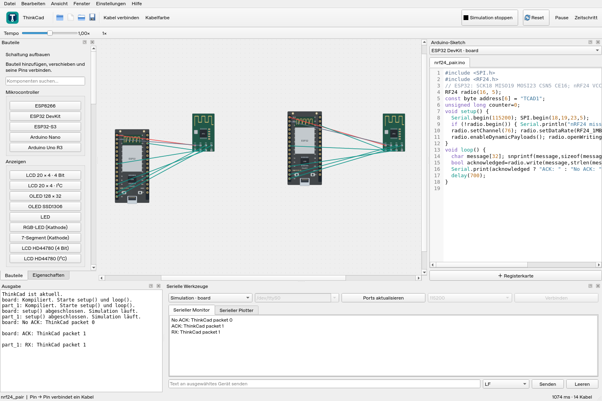

Separater ASK-Sender/-Empfänger bei 433,92 MHz, DATA-Pins und rc-switch-Protokoll 1.

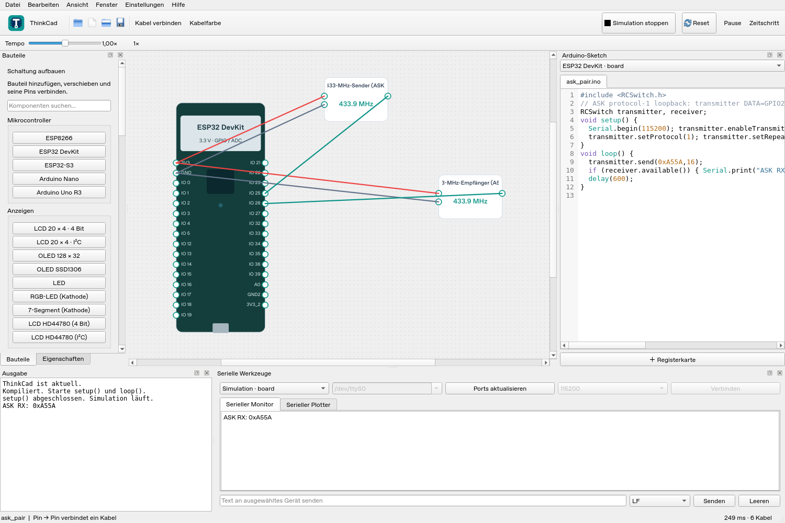
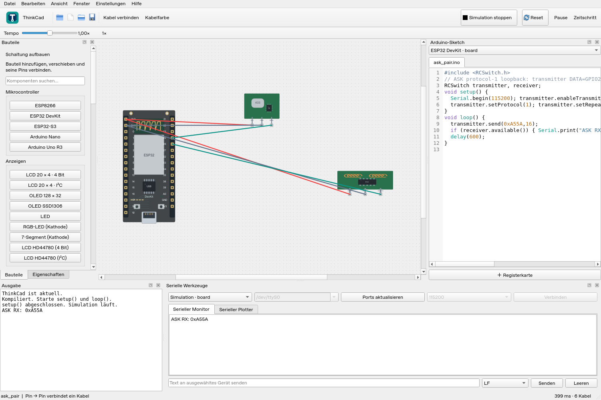

Die Prüfungen umfassen Empfang, fehlende Versorgung/Vorwiderstand, falsche
Frequenz/Kanal/Adresse/Datenrate/CRC, FIFO-Grenze, Kartenentfernung, UID/NDEF und
vollständige SDK-Sketches. Zusätzlich wurden für Uno-Pins angepasste Kopien aller
sechs Sketchdateien mit dem echten AVR-Core kompiliert: IRremote 4.7.1, Adafruit
PN532 1.3.4, Adafruit BusIO 1.17.4, RF24 1.6.2 und rc-switch 2.6.4. Das prüft API-
Kompatibilität, keine physische ESP32-Verbindung. Hardware und native Gentoo-/
Windows-Builds bleiben auf euren Rechnern zu prüfen.

[Anschluss- und API-Referenz mit Modellgrenzen](WIRELESS_MODULES.de.md).

UID/NDEF und Testgruppe lassen sich in den Karteneigenschaften ändern. Die
Prüfung speichert die Werte, lädt sie erneut und macht die Änderung rückgängig.

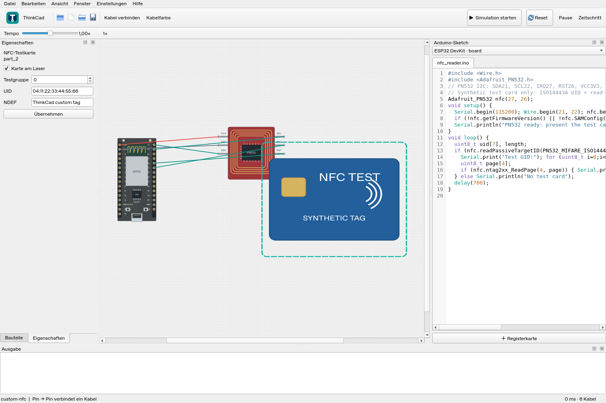
